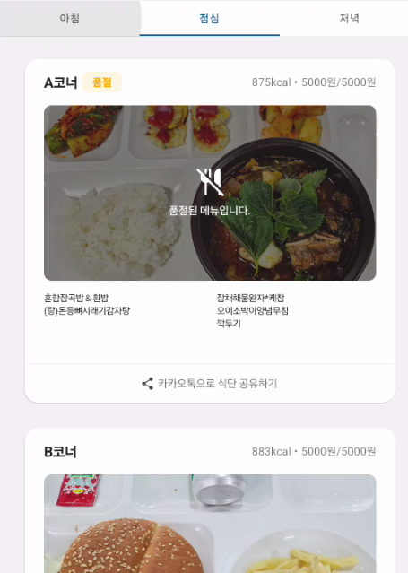

# 3-5. 식단_점심_스크롤

[← 식단 목록](README.md)

플랫폼: ANDROID, IOS, WEB  
원문 상태: 완료  
[Notion 기준 명세](https://app.notion.com/p/c1d0221954bc8293b36901b14f44ee6f)  
원본 ID: `c1d0221954bc8293b36901b14f44ee6f`

<!-- notion-body:start -->
## 과거 로깅

- 설명 : 식단 페이지에서 점심 식사 부분에서 스크롤
- event\_label : “menu\_time”
- value : “점심<b>”</b>
- event\_category : “scroll”
- 참고사진



## 새 로깅

- 레거시: 3-4로 통합. 새 로깅을 만들지 않는다.
- 대체 로깅 : 3-4 (cafeteria\_\_cafeteria\_\_meal\_time\_\_scroll)

### 참고사진 (레거시)

<b>웹</b>

<b>참고사진 · 웹</b>

해당 없음 (레거시)

<b>모바일</b>

<b>참고사진 · 모바일</b>

해당 없음 (레거시)
<!-- notion-body:end -->

<details>
<summary>Notion 원문 속성 전체</summary>

```json
{
  "platform": [
    "ANDROID",
    "IOS",
    "WEB"
  ],
  "url": "https://app.notion.com/p/c1d0221954bc8293b36901b14f44ee6f",
  "상태": "완료",
  "생성일": "2026-11-23T13:38:25.426Z",
  "이름": "3-5. 식단\\_점심\\_스크롤",
  "태그": [
    "3. 식단 상세페이지"
  ]
}
```

</details>
