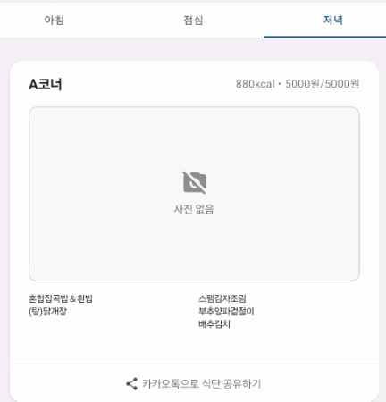

# 3-6. 식단_저녁_스크롤

[← 식단 로깅 목록](README.md)

플랫폼: ANDROID · IOS · WEB  
원문 상태: 완료

과거 로깅·새 로깅과 각 참고사진은 원문의 구간별 연결을 유지합니다.

원문 미기재 항목: `event_name`, `screen_view`. 값을 추정하지 않았습니다.

<!-- logging-section:past:start -->
## 과거 로깅

- 설명 : 식단 페이지에서 저녁 식사 부분에서 스크롤
- event\_label : “menu\_time”
- value : “저녁<b>”</b>
- event\_category : “scroll”

<!-- logging-section:past:end -->

<!-- logging-section:new:start -->
## 새 로깅

- 레거시: 3-4로 통합. 새 로깅을 만들지 않는다.
- 대체 로깅 : 3-4 (cafeteria\_\_cafeteria\_\_meal\_time\_\_scroll)

해당 없음 (레거시)

해당 없음 (레거시)

<!-- logging-section:new:end -->

---

원문 정보

원본 ID: `a230221954bc8369b994016a3caafcaf`  
[보존 원문](../../_archive/original/notion/pages/a230221954bc8369b994016a3caafcaf.md)

