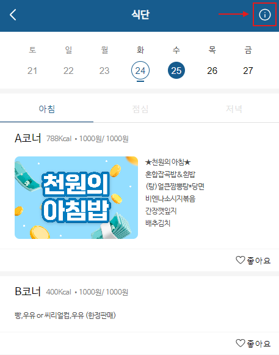
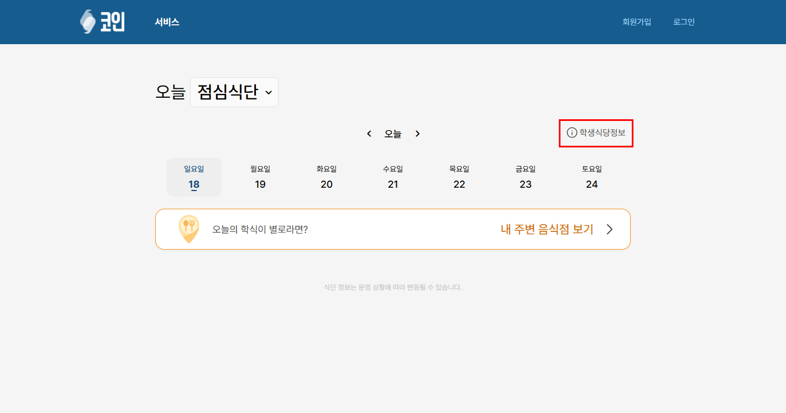
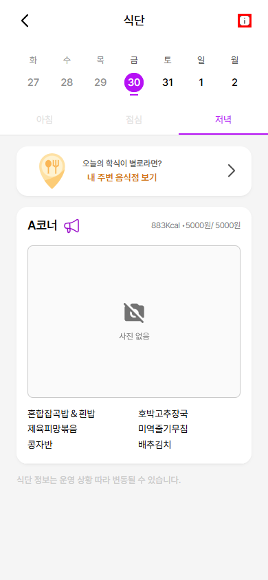

# 3-7. 식단_학생식당정보_클릭

[← 식단 로깅 목록](README.md)

플랫폼: ANDROID · IOS · WEB  
원문 상태: 완료

과거 로깅·새 로깅과 각 참고사진은 원문의 구간별 연결을 유지합니다.

<!-- logging-section:past:start -->
## 과거 로깅

<!-- logging-section:past:end -->

<!-- logging-section:new:start -->
## 새 로깅

- 설명: 식단 화면에서 학생식당정보 버튼(모바일은 우측 상단 i 아이콘)을 클릭해 학생식당 운영 정보를 보는 경우
- screen\_view: <code>cafeteria</code>
- event\_name: <code>DA1</code>
- event\_label: <code>cafeteria__cafeteria__cafeteria_info__entry__click</code>
- value: 학생식당정보
- event\_category: <code>click</code>

### 참고사진 (학생식당정보 클릭)

#### 웹

웹 — 학생식당정보 클릭 (출처: stage 실제 캡처, 빨간 네모 = 클릭 위치)

#### 모바일

모바일 웹 · 2026-10-30 운영 보라색 식단 실제 화면. 빨간 테두리=우측 상단 학생식당정보 i 아이콘. 생성형 이미지가 아닌 실제 브라우저 캡처이며 네이티브 앱·SDK 발화는 미확인이다.

<!-- logging-section:new:end -->

---

원문 정보

원본 ID: `1370221954bc82008ede81bb956111a7`  
[보존 원문](../../_archive/original/notion/pages/1370221954bc82008ede81bb956111a7.md)

