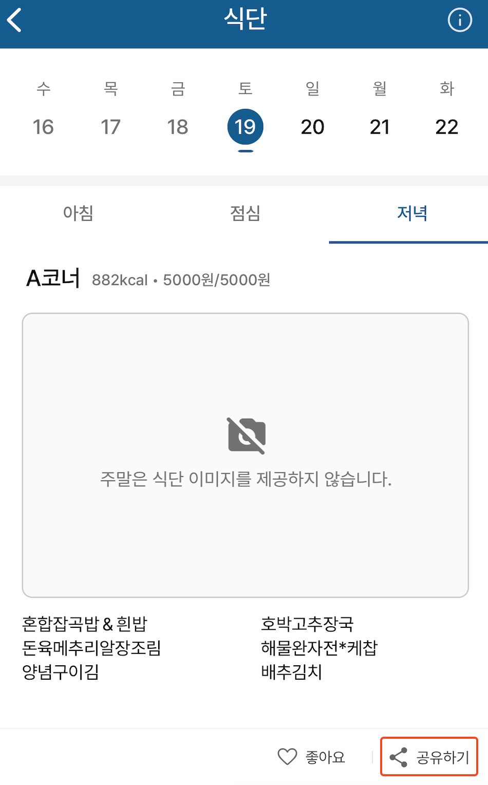
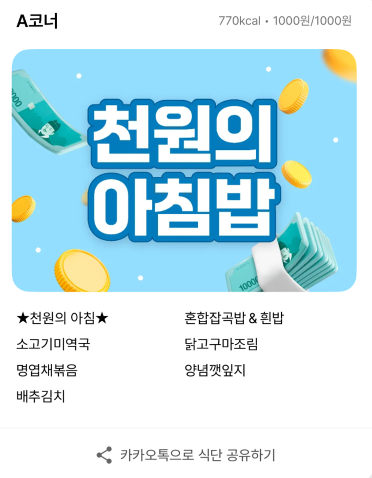

# 3-8. (Android / iOS) 식단_카카오톡_공유하기_클릭

[← 식단 로깅 목록](README.md)

플랫폼: ANDROID · IOS  
원문 상태: 완료

과거 로깅·새 로깅과 각 참고사진은 원문의 구간별 연결을 유지합니다.

<!-- logging-section:past:start -->
## 과거 로깅

- event\_label : “menu\_share”
- value : “공유하기<b>”</b>
- event\_category : “click”
- 참고사진

<!-- logging-section:past:end -->

<!-- logging-section:new:start -->
## 새 로깅

- 설명: 식단 화면에서 카카오톡 공유하기 버튼을 눌러 식단을 공유하는 경우 (식단 퍼널 마지막 단계)
- screen\_view: <code>cafeteria</code>
- event\_name: <code>DA1</code>
- event\_label: <code>cafeteria__cafeteria__share__kakao__click</code>
- value: 공유하기
- event\_category: <code>click</code>

### 참고사진 (카카오톡 공유하기)

<b>웹</b>

<b>참고사진 · 웹</b>

해당 없음 (앱 전용)

<b>모바일</b>

<b>참고사진 · 모바일</b>

<!-- logging-section:new:end -->

---

원문 정보

원본 ID: `9610221954bc82d09b750118aa5dc7aa`  
[보존 원문](../../_archive/original/notion/pages/9610221954bc82d09b750118aa5dc7aa.md)

