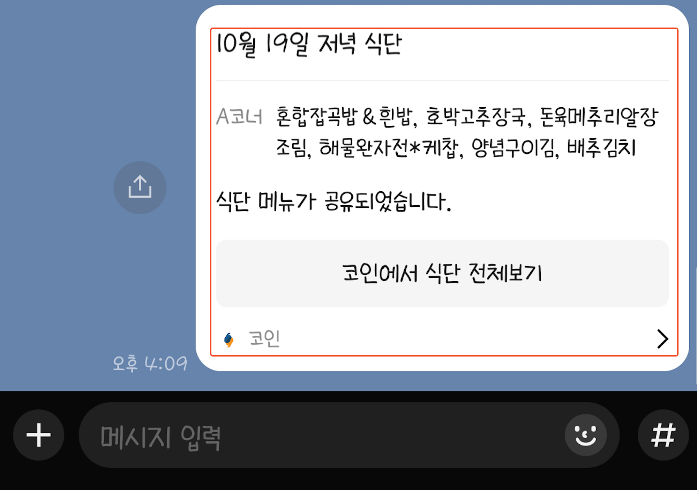

# 3-9. (Android / iOS) 식단_카카오톡_코인이동_클릭 (카카오톡)

[← 식단 로깅 목록](README.md)

플랫폼: ANDROID · IOS  
원문 상태: 완료

과거 로깅·새 로깅과 각 참고사진은 원문의 구간별 연결을 유지합니다.

<!-- logging-section:past:start -->
## 과거 로깅

- 설명 : 카톡으로 공유받은 식단 클릭
- event\_label : “menu\_share”
- value : “코인으로 이동<b>”</b>
- event\_category : “click”
- 참고사진

<!-- logging-section:past:end -->

<!-- logging-section:new:start -->
## 새 로깅

- 설명: 카카오톡으로 공유받은 식단 메시지에서 코인으로 이동을 눌러 앱 식단 화면으로 들어오는 경우 (기존에는 공유하기와 같은 라벨이라 분리)
- screen\_view: <code>from_external</code>
- event\_name: <code>DA1</code>
- event\_label: <code>cafeteria__from_external__cafeteria_entry__kakao_entry__click</code>
- value: 코인으로 이동
- event\_category: <code>click</code>

### 참고사진 (카카오톡 코인으로 이동)

<b>웹</b>

<b>참고사진 · 웹</b>

해당 없음 (앱 전용)

<b>모바일</b>

<b>참고사진 · 모바일</b>

<!-- logging-section:new:end -->

---

원문 정보

원본 ID: `7b80221954bc826aa9ea01960bfe1fa6`  
[보존 원문](../../_archive/original/notion/pages/7b80221954bc826aa9ea01960bfe1fa6.md)

