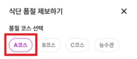
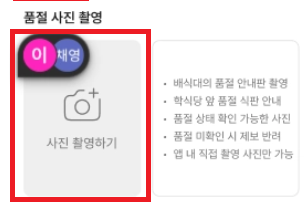
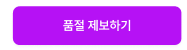
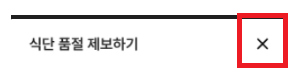

# 3. 품절 제보 버튼_버튼 내부

[← 식단 목록](README.md)

플랫폼: ANDROID, IOS, WEB  
원문 상태: 로깅 필요  
[Notion 기준 명세](https://app.notion.com/p/0350221954bc824b956b81bc446c46a5)  
원본 ID: `0350221954bc824b956b81bc446c46a5`

<!-- notion-body:start -->
## 과거 로깅

없음 (새로 추가한 로깅)

## 새 로깅

<b>A안</b>

<b>1-1. 품절 코너 선택</b>

- screen\_view: <code>cafeteria</code>
- event\_name: <code>DA1</code>
- event\_label: <code>cafeteria__dining__soldout__select</code>
- value: A안\_\{A코너 or B코너 or C코너 or 능수관\}
- event\_category: <code>select</code>

<b>1-2. 품절 사진 촬영</b>

- screen\_view: <code>cafeteria</code>
- event\_name: <code>DA1</code>
- event\_label: <code>cafeteria__dining__soldout__photo</code>
- value: A안\_\{사용자가 위에서 선택한 코너\}
- event\_category: <code>click</code>

<b>1-3. 품절 제보하기 버튼 클릭</b>

- screen\_view: <code>cafeteria</code>
- event\_name: <code>DA1</code>
- event\_label: <code>cafeteria__dining__soldout__submit</code>
- value: A안\_\{사용자가 위에서 선택한 코너\} (예: A안\_A코너)
- event\_category: <code>submit</code> (성공) / <code>fail</code> (실패)

<b>1-4. 품절 제보 이탈</b>

- screen\_view: <code>cafeteria</code>
- event\_name: <code>DA1</code>
- event\_label: <code>cafeteria__dining__soldout__exit</code>
- value:
  - 사용자가 코너를 선택하고 이탈한 경우: A안\_\{사용자가 위에서 선택한 코너\}\_이탈
  - 사용자가 코너를 선택하지 않고 이탈한 경우: A안\_이탈
- event\_category: <code>click</code>

<b>B안 (품절 코너 선택 칸 없음)</b>

<b>2-1. 품절 사진 촬영</b>

- screen\_view: <code>cafeteria</code>
- event\_name: <code>DA1</code>
- event\_label: <code>cafeteria__dining__soldout__photo</code>
- value: B안\_\{사용자가 진입한 코너\}
- event\_category: <code>click</code>

<b>2-2. 품절 제보 제출</b>

- screen\_view: <code>cafeteria</code>
- event\_name: <code>DA1</code>
- event\_label: <code>cafeteria__dining__soldout__submit</code>
- value: B안\_\{사용자가 진입한 코너\} (예: B안\_A코너)
- event\_category: <code>submit</code> (성공) / <code>fail</code> (실패)

<b>2-3. 품절 제보 이탈</b>

- screen\_view: <code>cafeteria</code>
- event\_name: <code>DA1</code>
- event\_label: <code>cafeteria__dining__soldout__exit</code>
- value: B안\_\{사용자가 진입한 코너\}\_이탈
- event\_category: <code>click</code>

### 참고사진 (품절 제보 버튼 내부)

<b>모바일</b>

<b>참고사진 · 모바일</b>

1-1. A안 품절 코너 선택



1-2. A안 품절 사진 촬영



1-3. A안 품절 제보하기 버튼 클릭



1-4. A안 품절 제보 이탈



2-1. B안 품절 사진 촬영


2-2. B안 품절 제보 제출


2-3. B안 품절 제보 이탈


<b>웹</b>

<b>참고사진 · 웹</b>

웹 — 사진 없음 (추가 필요)
<!-- notion-body:end -->

<details>
<summary>Notion 원문 속성 전체</summary>

```json
{
  "platform": [
    "ANDROID",
    "IOS",
    "WEB"
  ],
  "url": "https://app.notion.com/p/0350221954bc824b956b81bc446c46a5",
  "상태": "로깅 필요",
  "생성일": "2026-11-23T13:38:23.794Z",
  "이름": "3. 품절 제보 버튼\\_버튼 내부",
  "태그": [
    "0. A/B TEST"
  ]
}
```

</details>
