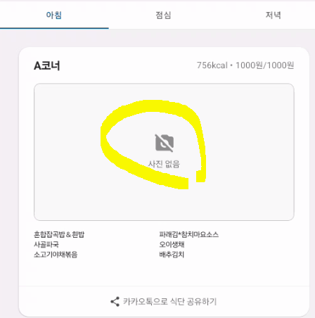
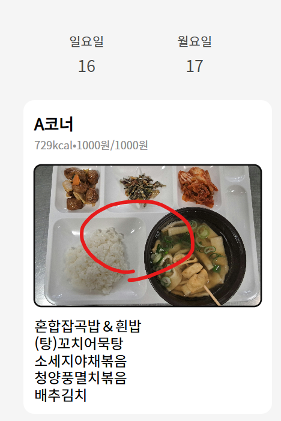
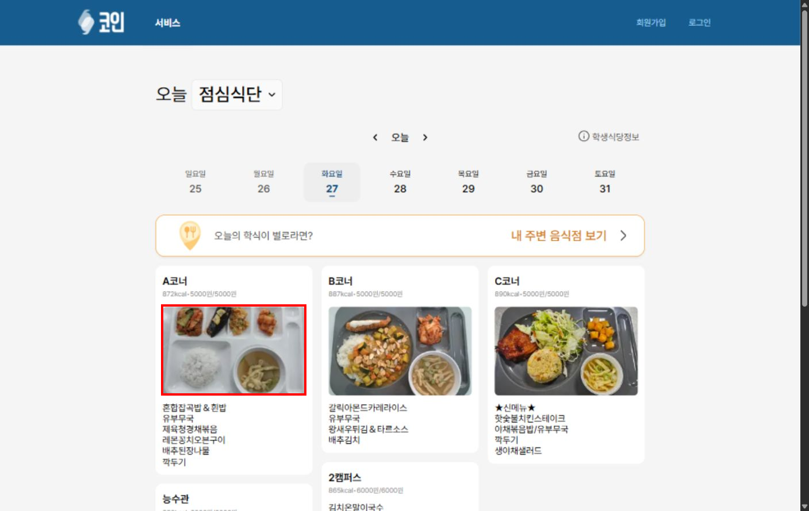
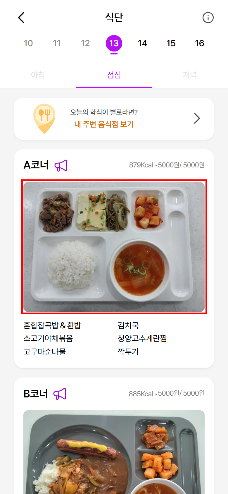

# 4-1. 식단_코너 사진_클릭

[← 식단 로깅 목록](README.md)

플랫폼: ANDROID · IOS · WEB  
원문 상태: 완료

과거 로깅·새 로깅과 각 참고사진은 원문의 구간별 연결을 유지합니다.

<!-- logging-section:past:start -->
## 과거 로깅

- 설명 : 식단페이지에서 아침 A코너 사진 클릭
- event\_label : “menu\_image”
- value : “아침\_A코너<b>”</b>
- event\_category : “click”

- 웹

<!-- logging-section:past:end -->

<!-- logging-section:new:start -->
## 새 로깅

- 설명: 식단 화면에서 코너의 식단 사진을 클릭하는 경우
- screen\_view: <code>cafeteria</code>
- event\_name: <code>DA1</code>
- event\_label: <code>cafeteria__cafeteria__photo_view__open__click</code>
- value: \{식사 시간\}\_\{코너\} (예: 아침\_A코너)
- event\_category: <code>click</code>

### 참고사진 (코너 사진 클릭)

#### 웹

WEB · 빨간 네모: 식단 코너 사진 클릭. stage 실제 화면 캡처에 위치 표시.

#### 모바일

모바일 — 코너 식단 사진 클릭 (출처: stage 실제 캡처, 빨간 네모 = 클릭 위치)

<!-- logging-section:new:end -->

---

원문 정보

원본 ID: `b3d0221954bc828fbdf7014674efb010`  
[보존 원문](../../_archive/original/notion/pages/b3d0221954bc828fbdf7014674efb010.md)

