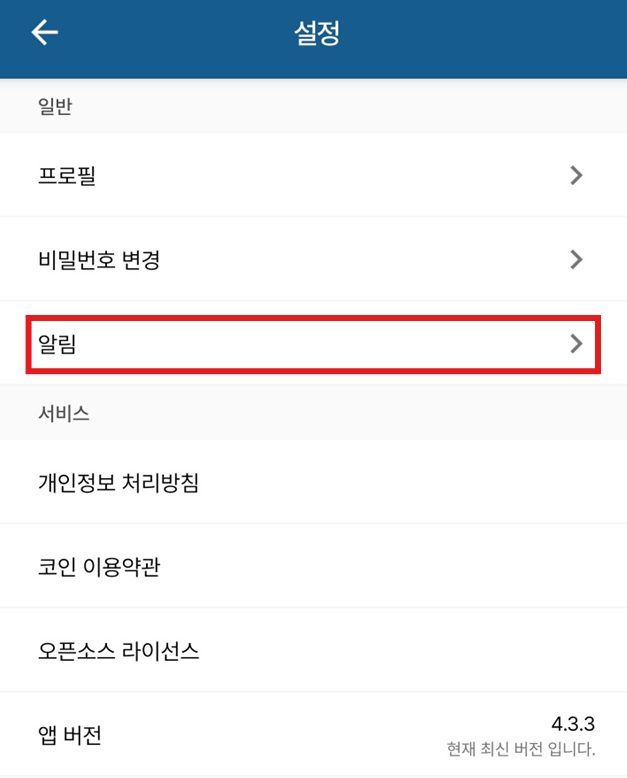
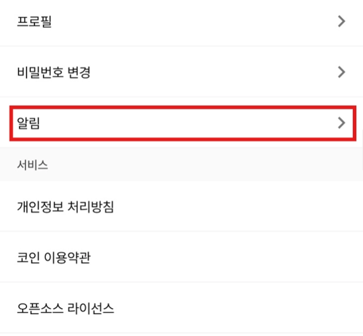

# 5-1. (Android / iOS) 알림설정_클릭

[← 식단 목록](README.md)

플랫폼: ANDROID, IOS  
원문 상태: 완료  
[Notion 기준 명세](https://app.notion.com/p/0b20221954bc83889fbd018d543903a3)  
원본 ID: `0b20221954bc83889fbd018d543903a3`

<!-- notion-body:start -->
## 과거 로깅

- 설명 : 설정에서 알림 클릭
- event\_label : “notification”
- value : “알림설정<b>”</b>
- event\_category : “click”
- 참고사진



## 새 로깅

- 설명: 프로필 → 설정 화면에서 알림을 클릭해 알림 설정 화면으로 들어가는 경우
- screen\_view: <code>account_config</code>
- event\_name: <code>DA1</code>
- event\_label: <code>cafeteria__account_config__notification_config__entry__click</code>
- value: 알림설정
- event\_category: <code>click</code>

### 참고사진 (알림설정 클릭)

<b>웹</b>

<b>참고사진 · 웹</b>

해당 없음 (앱 전용)

<b>모바일</b>

<b>참고사진 · 모바일</b>


<!-- notion-body:end -->

<details>
<summary>Notion 원문 속성 전체</summary>

```json
{
  "platform": [
    "ANDROID",
    "IOS"
  ],
  "url": "https://app.notion.com/p/0b20221954bc83889fbd018d543903a3",
  "상태": "완료",
  "생성일": "2026-11-23T13:38:25.871Z",
  "이름": "5-1. (Android / iOS) 알림설정\\_클릭",
  "태그": [
    "5. 알림설정 페이지 (Android / iOS)"
  ]
}
```

</details>
