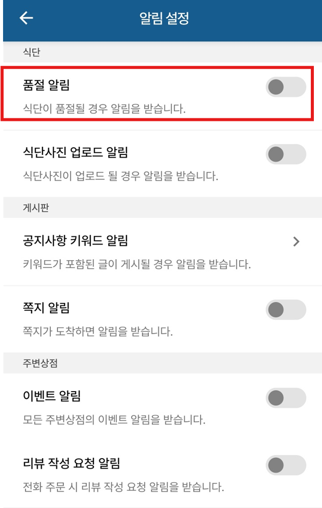

# 5-2. (Android / iOS) 알림설정_품절_토글

[← 식단 목록](README.md)

플랫폼: ANDROID, IOS  
원문 상태: 완료  
[Notion 기준 명세](https://app.notion.com/p/0300221954bc8285980681c970789491)  
원본 ID: `0300221954bc8285980681c970789491`

<!-- notion-body:start -->
## 과거 로깅

- 설명 : 알림 설정에서 품절 알림 클릭
- event\_label : “notification\_sold\_out”
- value : “on/off<b>”</b>
- event\_category : “click”
- 참고사진



## 새 로깅

- 설명: 프로필 → 설정 → 알림 화면에서 품절 알림 토글을 켜거나 끄는 경우
- screen\_view: <code>notification_config</code>
- event\_name: <code>DA1</code>
- event\_label: <code>cafeteria__notification_config__sold_out__toggle</code>
- value: 켜짐 / 꺼짐 (예: 켜짐)
- event\_category: <code>toggle</code>

### 참고사진 (품절 알림 토글)

<b>웹</b>

<b>참고사진 · 웹</b>

해당 없음 (앱 전용)

<b>모바일</b>

<b>참고사진 · 모바일</b>

앱 전용 화면 (웹 없음), 앱 캡처 필요
<!-- notion-body:end -->

<details>
<summary>Notion 원문 속성 전체</summary>

```json
{
  "platform": [
    "ANDROID",
    "IOS"
  ],
  "url": "https://app.notion.com/p/0300221954bc8285980681c970789491",
  "상태": "완료",
  "생성일": "2026-11-23T13:38:24.852Z",
  "이름": "5-2. (Android / iOS) 알림설정\\_품절\\_토글",
  "태그": [
    "5. 알림설정 페이지 (Android / iOS)"
  ]
}
```

</details>
