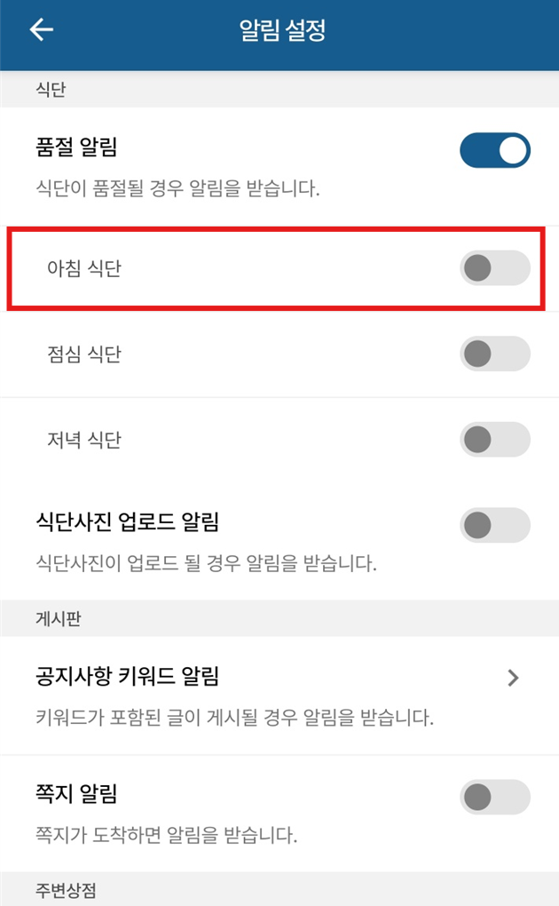

# 5-3. (Android / iOS) 알림설정_품절_식사시간_토글

[← 식단 로깅 목록](README.md)

플랫폼: ANDROID · IOS  
원문 상태: 완료

과거 로깅·새 로깅과 각 참고사진은 원문의 구간별 연결을 유지합니다.

<!-- logging-section:past:start -->
## 과거 로깅

- 설명 : 품절 알림에서 아침 식단 클릭
- event\_label : “notification\_breakfast\_sold\_out”
- value : “on/off<b>”</b>
- event\_category : “click”

<!-- logging-section:past:end -->

<!-- logging-section:new:start -->
## 새 로깅

- 설명: 프로필 → 설정 → 알림 화면의 품절 알림에서 식사 시간(아침/점심/저녁)별 토글을 켜거나 끄는 경우
- screen\_view: <code>notification_config</code>
- event\_name: <code>DA1</code>
- event\_label: <code>cafeteria__notification_config__sold_out_meal__toggle</code>
- value: \{식사 시간\}\_\{켜짐/꺼짐\} (예: 아침\_켜짐)
- event\_category: <code>toggle</code>

해당 없음 (앱 전용)

앱 전용 화면 (웹 없음), 앱 캡처 필요

<!-- logging-section:new:end -->

---

원문 정보

원본 ID: `bfe0221954bc829dac0501c57175d4e1`  
[보존 원문](../../_archive/original/notion/pages/bfe0221954bc829dac0501c57175d4e1.md)

