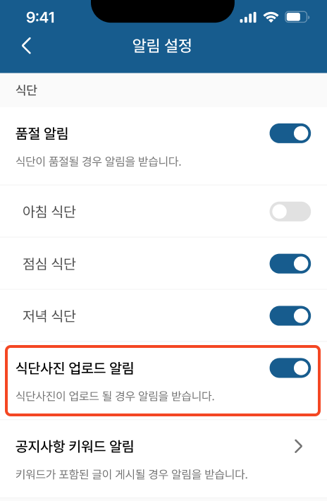

# 5-6. (Android / iOS) 알림설정_식단사진 업로드_토글

[← 식단 로깅 목록](README.md)

플랫폼: ANDROID · IOS  
원문 상태: 완료

과거 로깅·새 로깅과 각 참고사진은 원문의 구간별 연결을 유지합니다.

<!-- logging-section:past:start -->
## 과거 로깅

- event\_label : “notification\_menu\_image\_upload”
- value : “on/off<b>”</b>
- event\_category : “click”
- 참고사진

<!-- logging-section:past:end -->

<!-- logging-section:new:start -->
## 새 로깅

- 설명: 프로필 → 설정 → 알림 화면에서 식단 사진 업로드 알림 토글을 켜거나 끄는 경우
- screen\_view: <code>notification_config</code>
- event\_name: <code>DA1</code>
- event\_label: <code>cafeteria__notification_config__notification_config__photo_upload__toggle</code>
- value: 켜짐 / 꺼짐 (예: 켜짐)
- event\_category: <code>toggle</code>

### 참고사진 (식단 사진 업로드 알림 토글)

<b>웹</b>

<b>참고사진 · 웹</b>

해당 없음 (앱 전용)

<b>모바일</b>

<b>참고사진 · 모바일</b>

출처: 이 페이지 이전 로깅의 기존 앱 참고사진 사본. 표시 대상은 현행 설명과 대조했으며, 현행 앱의 화면·구현은 미검증입니다. 빨간 네모는 동작 대상입니다.

파란색 구버전 모바일 사진 제거 (2026-10-30).

<!-- logging-section:new:end -->

---

원문 정보

원본 ID: `c7f0221954bc82e4b63f01f4acf751e8`  
[보존 원문](../../_archive/original/notion/pages/c7f0221954bc82e4b63f01f4acf751e8.md)

