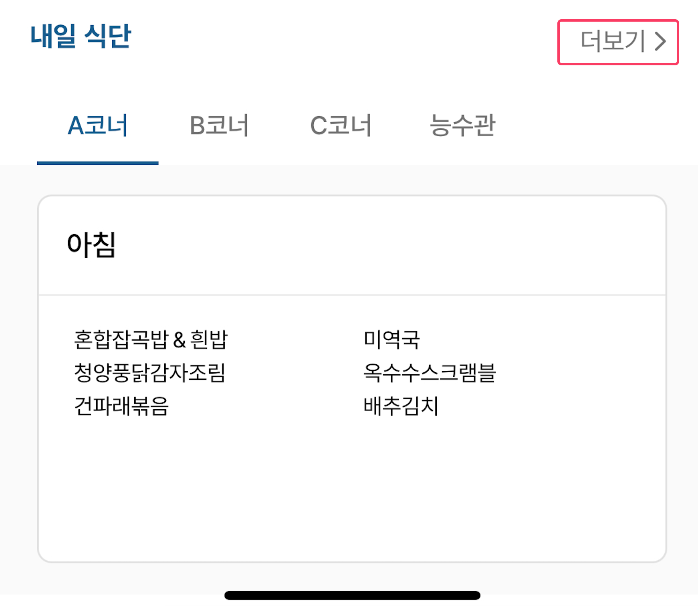
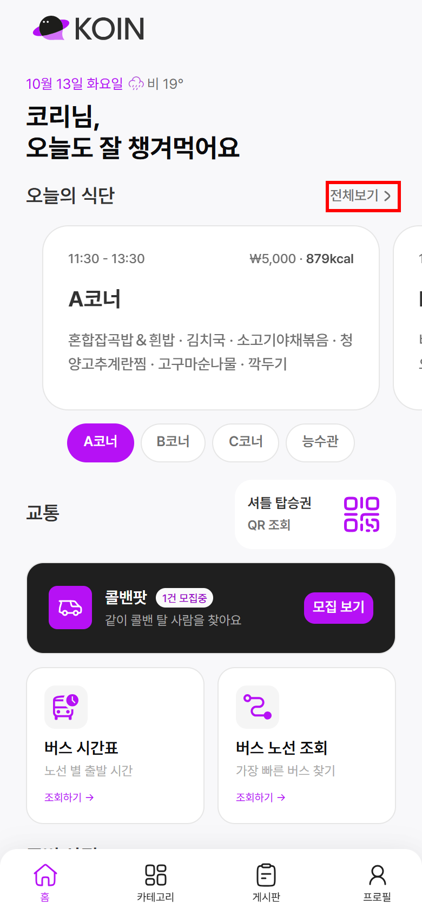

# [레거시] [레거시] 메인_식단_더보기버튼_클릭(확인필요)

> **레거시 문서** · 과거 구현과 로깅을 확인하기 위한 보존 자료입니다.

[← 식단 로깅 목록](README.md)

플랫폼: ANDROID · IOS  
원문 상태: 진행 중

과거 로깅·새 로깅과 각 참고사진은 원문의 구간별 연결을 유지합니다.

<callout icon="📁" color="gray_bg">
<b>레거시·참조 명세 — 별도 구현 대상 아님</b>

- 2026-11-04 사용자 요청에 따라 중복·참조 관계를 정리했다. 식단 더보기의 현행 대표 명세는 [1-3 메인 식단 진입 클릭](../10-%ED%99%88%ED%99%94%EB%A9%B4-%EB%A6%AC%EB%94%94%EC%9E%90%EC%9D%B8/1-3-%EB%A9%94%EC%9D%B8-%EC%8B%9D%EB%8B%A8-%EC%A7%84%EC%9E%85-%ED%81%B4%EB%A6%AD.md)이며 적용 라벨은 <code>main__main__more__click</code>이다.
- 이 문서의 이전 label·value·category·event\_name·사진·플랫폼은 이력으로 보존한다. 아래 과거 ‘기준 명세’·‘별개 유지’ 설명보다 이 결정이 우선한다. 이 페이지를 근거로 이벤트를 추가 전송하지 않는다.
- 실제 SDK의 과거 호출 중단·새 라벨 전환·단일 전송은 개발 검증이 필요하다. 이 DB에는 레거시 상태 옵션이 없어 공용 옵션을 새로 만들지 않고 제목·본문으로 레거시를 표시했다.
</callout>

<!-- logging-section:past:start -->
## 이전 로깅

- event\_label : “main\_menu\_more”
- value : “더보기<b>”</b>
- event\_category : “click”

<!-- logging-section:past:end -->

이관 전 새 로깅 (26.10.17) — 레거시 보존

- 설명: 메인 화면의 식단 영역에서 더보기 버튼을 눌러 식단 화면으로 들어가는 경우
- screen\_view: <code>main</code>
- event\_name: <code>DA1</code>
- event\_label: <code>cafeteria__main__more__click</code>
- value: \{아침, 점심, 저녁\}\_더보기 (예: 점심\_더보기)
- event\_category: <code>click</code>

검토사항

- 통합 가이드·후속: 원문 (원문 ID: 4129ae650b598060bb4bdf347b7d4c7a)
- 참고: 1-1과 같은 로깅(중복 페이지). 1-1 기준으로 관리한다.
- 명세 중복 정리 (2026-10-27): <code>cafeteria__main__more__click</code>의 기준 명세는 [1-1.메인_식단_더보기버튼_클릭 (홈화면 리디자인 로깅으로 찍히고 있음) → 따라서  1-1부터 1-7까지 전부 다 수정할 필요 없음 (레거시)](1-1.%EB%A9%94%EC%9D%B8_%EC%8B%9D%EB%8B%A8_%EB%8D%94%EB%B3%B4%EA%B8%B0%EB%B2%84%ED%8A%BC_%ED%81%B4%EB%A6%AD-%28%ED%99%88%ED%99%94%EB%A9%B4-%EB%A6%AC%EB%94%94%EC%9E%90%EC%9D%B8-%EB%A1%9C%EA%B9%85%EC%9C%BC%EB%A1%9C-%EC%B0%8D%ED%9E%88%EA%B3%A0-%EC%9E%88%EC%9D%8C%29-%E2%86%92-%EB%94%B0%EB%9D%BC%EC%84%9C-1-1%EB%B6%80%ED%84%B0-1-7%EA%B9%8C%EC%A7%80-%EC%A0%84%EB%B6%80-%EB%8B%A4-%EC%88%98%EC%A0%95%ED%95%A0-%ED%95%84%EC%9A%94-%EC%97%86%EC%9D%8C-%28%EB%A0%88%EA%B1%B0%EC%8B%9C%29.md). 기존 1-1의 같은 더보기 이벤트를 설명하는 중복 참고 명세다. 같은 사용자 동작은 한 번만 전송하며, 문서가 여러 개라는 이유로 추가 이벤트를 보내지 않는다. 기존 value·플랫폼·발생 시점은 유지한다.

참고사진 · 웹

해당 없음 (DB platform: 앱 전용)

참고사진 · 모바일

모바일 — 메인 식단 더보기 클릭 (출처: stage 실제 캡처, 빨간 네모 = 클릭 위치)

---

원문 정보

원본 ID: `3d50221954bc8228a8ed81c51f8aa5d6`  
[보존 원문](../../_archive/original/notion/pages/3d50221954bc8228a8ed81c51f8aa5d6.md)

