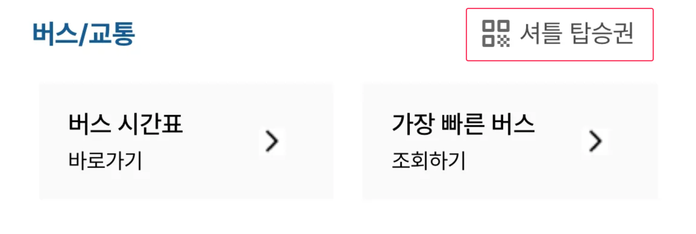
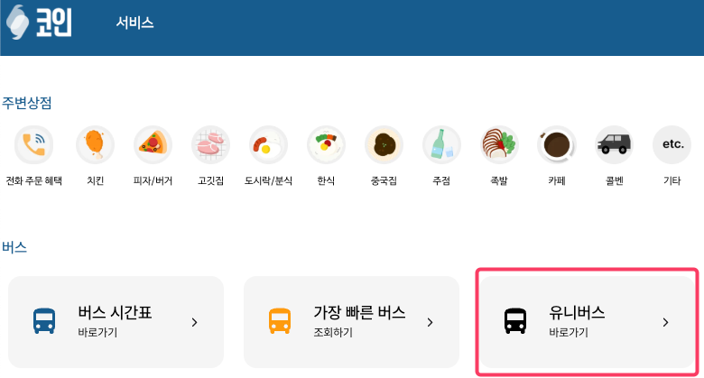

# 1-11. 셔틀 탑승권_클릭 (레거시)

[← 버스 목록](README.md)

플랫폼: ANDROID, IOS, WEB  
원문 상태: 로깅 필요  
[Notion 기준 명세](https://app.notion.com/p/e550221954bc83fca3508135c012c504)  
원본 ID: `e550221954bc83fca3508135c012c504`

<!-- notion-body:start -->
<b>레거시 보존 · 현행 새 로깅은 홈으로 이관</b>

- 2026-11-04 사용자 지시로 이 페이지는 이력만 보존한다.
- 현행 기준 명세: [1-5 서틀 탑승권 클릭](https://app.notion.com/p/5cf0221954bc8356b2b981d586d648af).
- 이관 후 event\_label: <code>main__main__bus_entry__ticket_entry__click</code>. 아래 이관 전 라벨·값·사진은 보존 기록이며 별도 신규 구현·추가 전송 대상으로 사용하지 않는다.
- 실제 SDK 전환·배포·수집 중단 여부는 미확인이다. 기존 플랫폼과 상태 속성은 유지했다.

## 이전 로깅

- event\_label : “shuttle\_ticket”
- value : “셔틀 탑승권<b>”</b>
- event\_category : “click”
- 참고사진


AND, IOS, WEB(Mobile view)


WEB
<!-- notion-body:end -->

<details>
<summary>Notion 원문 속성 전체</summary>

```json
{
  "platform": [
    "ANDROID",
    "IOS",
    "WEB"
  ],
  "url": "https://app.notion.com/p/e550221954bc83fca3508135c012c504",
  "상태": "로깅 필요",
  "생성일": "2026-11-23T13:38:27.721Z",
  "이벤트 이름": "1-11. 셔틀 탑승권\\_클릭 (레거시)",
  "태그": [
    "1. 메인_버스/교통"
  ]
}
```

</details>
