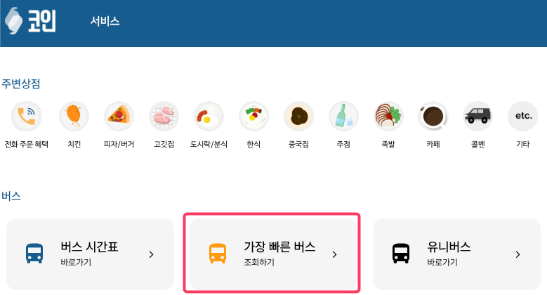

# 1-13. 교통편 조회하기_클릭 (레거시)

[← 버스 목록](README.md)

플랫폼: ANDROID, IOS, WEB  
원문 상태: 로깅 필요  
[Notion 기준 명세](https://app.notion.com/p/2b30221954bc827b952a81d9c6dc5b1e)  
원본 ID: `2b30221954bc827b952a81d9c6dc5b1e`

<!-- notion-body:start -->
## 현재 WEB 참고사진 · Stage 실제 배포 화면

2026-11-08 [Stage 실제 서비스](https://stage.koreatech.in/) · PC 1440px 브라우저에서 직접 촬영했다. 빨간 테두리는 해당 명세의 버튼 위치다. 아래의 Figma 리디자인 시안·이전 WEB 캡처는 이력으로 보존하며, 현재 WEB 위치 확인에는 이 실제 화면을 우선한다. 모바일 사진·기존 로깅 필드·DB 플랫폼 속성은 유지한다. 화면 확인은 SDK 전송·GA4 수집 검수 완료를 뜻하지 않는다.


<b>레거시 보존 · 현행 새 로깅은 홈으로 이관</b>

- 2026-11-04 사용자 지시로 이 페이지는 이력만 보존한다.
- 현행 기준 명세: [1-8 버스 노선 클릭](https://app.notion.com/p/93c0221954bc82a5b20701ce5f75c697).
- 이관 후 event\_label: <code>main__main__bus_entry__search_entry__click</code>. 아래 이관 전 라벨·값·사진은 보존 기록이며 별도 신규 구현·추가 전송 대상으로 사용하지 않는다.
- 실제 SDK 전환·배포·수집 중단 여부는 미확인이다. 기존 플랫폼과 상태 속성은 유지했다.

## 이전 로깅

- event\_label : “main\_bus\_search”
- value : “가장 빠른 버스 조회하기<b>”</b>
- event\_category : “click”
- 참고사진


AND, IOS, WEB(Mobile view)


WEB
<!-- notion-body:end -->

<details>
<summary>Notion 원문 속성 전체</summary>

```json
{
  "platform": [
    "ANDROID",
    "IOS",
    "WEB"
  ],
  "url": "https://app.notion.com/p/2b30221954bc827b952a81d9c6dc5b1e",
  "상태": "로깅 필요",
  "생성일": "2026-11-23T13:38:28.142Z",
  "이벤트 이름": "1-13. 교통편 조회하기\\_클릭 (레거시)",
  "태그": [
    "1. 메인_버스/교통"
  ]
}
```

</details>
