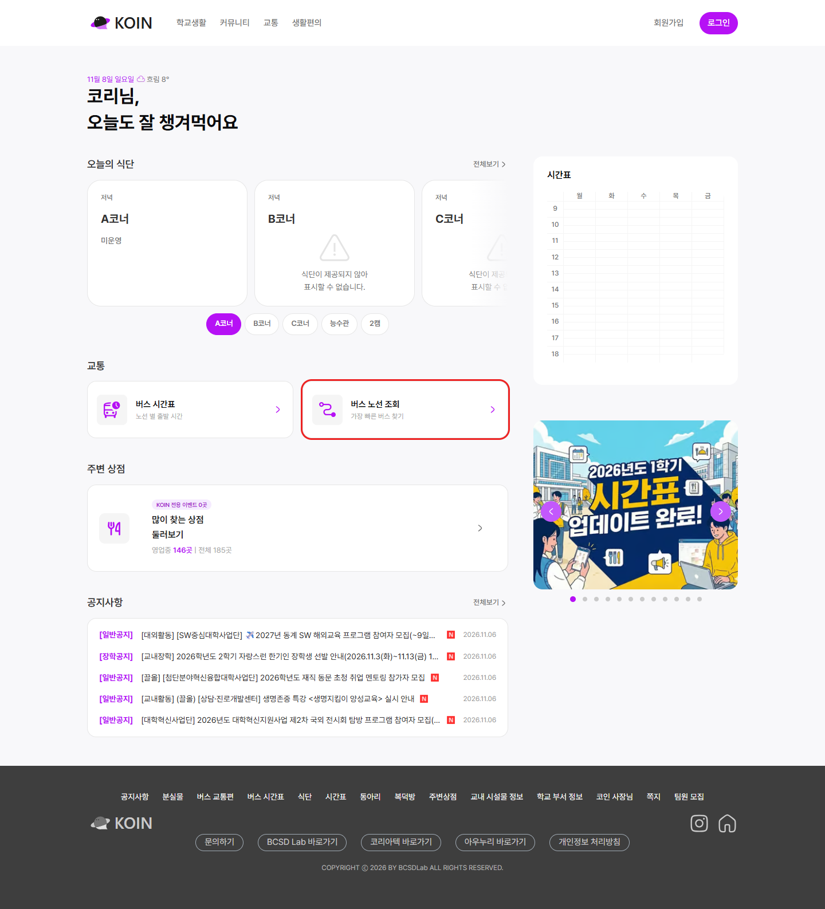
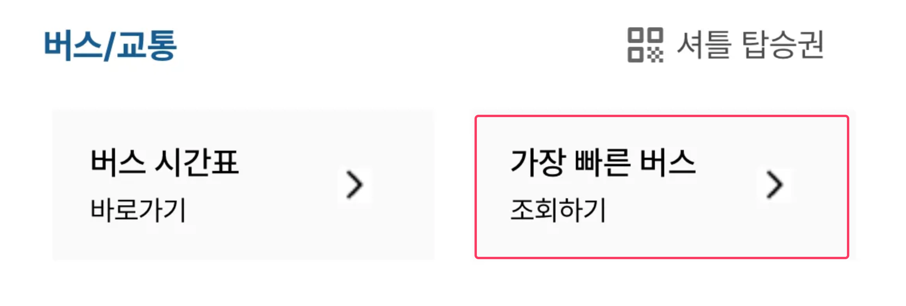

# 1-13. 교통편 조회하기_클릭 (레거시)

[← 버스 로깅 목록](README.md)

플랫폼: ANDROID · IOS · WEB  
원문 상태: 로깅 필요

과거 로깅·새 로깅과 각 참고사진은 원문의 구간별 연결을 유지합니다.

원문 미기재 항목: `event_name`, `screen_view`. 값을 추정하지 않았습니다.

현재 WEB 참고사진 · Stage 실제 배포 화면

2026-11-08 [Stage 실제 서비스](https://stage.koreatech.in/) · PC 1440px 브라우저에서 직접 촬영했다. 빨간 테두리는 해당 명세의 버튼 위치다. 아래의 Figma 리디자인 시안·이전 WEB 캡처는 이력으로 보존하며, 현재 WEB 위치 확인에는 이 실제 화면을 우선한다. 모바일 사진·기존 로깅 필드·DB 플랫폼 속성은 유지한다. 화면 확인은 SDK 전송·GA4 수집 검수 완료를 뜻하지 않는다.

<callout icon="📁" color="gray_bg">
<b>레거시 보존 · 현행 새 로깅은 홈으로 이관</b>

- 2026-11-04 사용자 지시로 이 페이지는 이력만 보존한다.
- 현행 기준 명세: [1-8 버스 노선 클릭](../10-%ED%99%88%ED%99%94%EB%A9%B4-%EB%A6%AC%EB%94%94%EC%9E%90%EC%9D%B8/1-8-%EB%B2%84%EC%8A%A4-%EB%85%B8%EC%84%A0-%ED%81%B4%EB%A6%AD.md).
- 이관 후 event\_label: <code>main__main__bus_entry__search_entry__click</code>. 아래 이관 전 라벨·값·사진은 보존 기록이며 별도 신규 구현·추가 전송 대상으로 사용하지 않는다.
- 실제 SDK 전환·배포·수집 중단 여부는 미확인이다. 기존 플랫폼과 상태 속성은 유지했다.
</callout>

<!-- logging-section:past:start -->
## 이전 로깅

- event\_label : “main\_bus\_search”
- value : “가장 빠른 버스 조회하기<b>”</b>
- event\_category : “click”
- 참고사진

AND, IOS, WEB(Mobile view)

WEB

<!-- logging-section:past:end -->

---

원문 정보

원본 ID: `4e50221954bc8328aac80133ab34507e`  
[보존 원문](../../_archive/original/notion/pages/4e50221954bc8328aac80133ab34507e.md)

