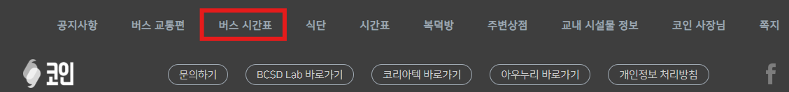
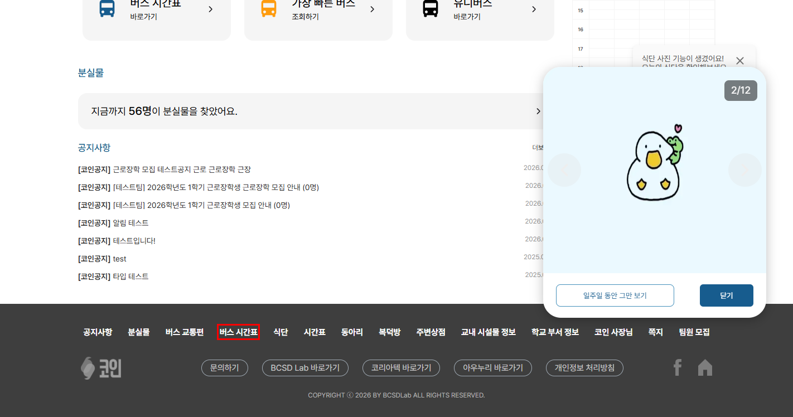

# 2-2. 푸터_버스 시간표_클릭

[← 버스 목록](README.md)

플랫폼: WEB  
원문 상태: 완료  
[Notion 기준 명세](https://app.notion.com/p/4690221954bc8279b61001155cdbc34e)  
원본 ID: `4690221954bc8279b61001155cdbc34e`

<!-- notion-body:start -->
## 과거 로깅

- event\_label : “footer”
- value : “버스 시간표<b>”</b>
- event\_category : “click”
- 참고사진



## 새 로깅

- 설명: 웹 하단 푸터에서 버스 시간표를 클릭해 버스 시간표 화면으로 들어가는 경우
- screen\_view: <code>footer</code>
- event\_name: <code>DA1</code>
- event\_label: <code>bus__footer__timetable__click</code>
- value: 버스 시간표
- event\_category: <code>click</code>

### 참고사진 (기능 표시)

<b>웹</b>

<b>참고사진 · 웹</b>

웹 — 푸터 버스 시간표 (출처: stage 실제 캡처, 빨간 네모 = 클릭 위치)



<b>모바일</b>

<b>참고사진 · 모바일</b>

모바일 — 해당 없음 (웹 전용)
<!-- notion-body:end -->

<details>
<summary>Notion 원문 속성 전체</summary>

```json
{
  "platform": [
    "WEB"
  ],
  "url": "https://app.notion.com/p/4690221954bc8279b61001155cdbc34e",
  "상태": "완료",
  "생성일": "2026-11-23T13:38:33.355Z",
  "이벤트 이름": "2-2. 푸터\\_버스 시간표\\_클릭",
  "태그": [
    "2. 헤더/푸터/햄버거_버스/교통"
  ]
}
```

</details>
