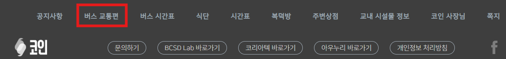

# 2-4. 푸터_버스 교통편_클릭

[← 버스 목록](README.md)

플랫폼: WEB  
원문 상태: 완료  
[Notion 기준 명세](https://app.notion.com/p/92e0221954bc833cb7fe0117dbf7ea59)  
원본 ID: `92e0221954bc833cb7fe0117dbf7ea59`

<!-- notion-body:start -->
## 과거 로깅

- event\_label : “footer”
- value : “버스 교통편<b>”</b>
- event\_category : “click”
- 참고사진



## 새 로깅

- 설명: 웹 하단 푸터에서 버스 교통편을 클릭해 버스 교통편 조회 화면으로 들어가는 경우
- screen\_view: <code>footer</code>
- event\_name: <code>DA1</code>
- event\_label: <code>bus__footer__route__click</code>
- value: 버스 교통편
- event\_category: <code>click</code>

### 참고사진 (WEB 리디자인 · 푸터 버스 교통편)

<b>웹</b>

<b>참고사진 · 웹</b>

[Figma 원본](https://www.figma.com/design/DPlcYuiFxhyT5ULbqec59i/KOIN-Web?node-id=17664-28870) · 2026-11-04. 원본 캡처에 빨간 네모만 추가했다. 빨간 네모는 기존 명세의 버스 교통편 클릭 위치다. 실제 SDK 적용·배포·전송은 미확인이다.


<!-- notion-body:end -->

<details>
<summary>Notion 원문 속성 전체</summary>

```json
{
  "platform": [
    "WEB"
  ],
  "url": "https://app.notion.com/p/92e0221954bc833cb7fe0117dbf7ea59",
  "상태": "완료",
  "생성일": "2026-11-23T13:38:26.640Z",
  "이벤트 이름": "2-4. 푸터\\_버스 교통편\\_클릭",
  "태그": [
    "2. 헤더/푸터/햄버거_버스/교통"
  ]
}
```

</details>
