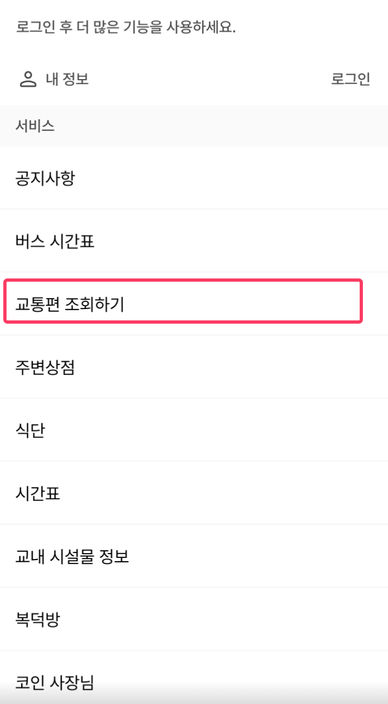

# 2-5. (앱) 햄버거_교통편 조회하기_클릭 → 삭제

[← 버스 목록](README.md)

플랫폼: ANDROID, IOS, WEB  
원문 상태: 로깅 필요  
[Notion 기준 명세](https://app.notion.com/p/0f80221954bc8391ad5d8142d80ac447)  
원본 ID: `0f80221954bc8391ad5d8142d80ac447`

<!-- notion-body:start -->
2026-11-08 이 옛 앱 햄버거 명세의 삭제·레거시 결정은 유지한다. 현재 모바일 WEB /category의 교통편 조회하기 메뉴는 [Notion 원문](https://app.notion.com/p/4120221954bc813a91caf8623f3cfec0)의 새 계약을 따른다. PC 헤더·홈 카드 라벨을 대신 보내거나 이 옛 명세를 되살리지 않는다. SDK 배포·실수집 검수는 별도다.

## 이전 로깅

- event\_label : “hamburger”
- value : “교통편 조회하기<b>”</b>
- event\_category : “click”
- 참고사진


<!-- notion-body:end -->

<details>
<summary>Notion 원문 속성 전체</summary>

```json
{
  "platform": [
    "ANDROID",
    "IOS",
    "WEB"
  ],
  "url": "https://app.notion.com/p/0f80221954bc8391ad5d8142d80ac447",
  "상태": "로깅 필요",
  "생성일": "2026-11-23T13:38:30.588Z",
  "이벤트 이름": "2-5. (앱) 햄버거\\_교통편 조회하기\\_클릭 → 삭제",
  "태그": [
    "2. 헤더/푸터/햄버거_버스/교통"
  ]
}
```

</details>
