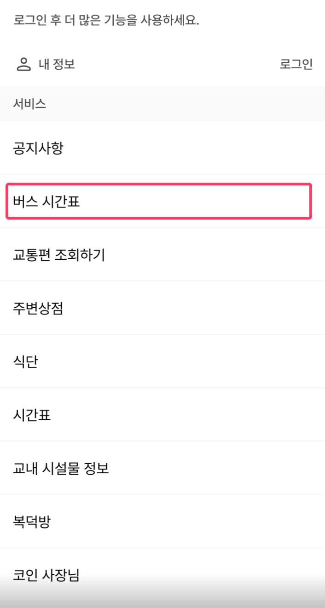

# 2-6. (앱) 햄버거_버스 시간표_클릭 → 삭제

[← 버스 로깅 목록](README.md)

플랫폼: ANDROID · IOS · WEB  
원문 상태: 로깅 필요

과거 로깅·새 로깅과 각 참고사진은 원문의 구간별 연결을 유지합니다.

원문 미기재 항목: `event_name`, `screen_view`. 값을 추정하지 않았습니다.

<callout icon="📌" color="gray_bg">
2026-11-08 이 옛 앱 햄버거 명세의 삭제·레거시 결정은 유지한다. 현재 모바일 WEB /category의 버스 시간표 메뉴는 원문 (원문 ID: 4120221954bc81c08b5ed63eff880be6)의 새 계약을 따른다. PC 헤더·홈 카드 라벨을 대신 보내거나 이 옛 명세를 되살리지 않는다. SDK 배포·실수집 검수는 별도다.
</callout>

<!-- logging-section:past:start -->
## 이전 로깅

- event\_label : “hamburger”
- value : “버스 시간표<b>”</b>
- event\_category : “click”
- 참고사진

<!-- logging-section:past:end -->

---

원문 정보

원본 ID: `9300221954bc83d0a705817c2c9244f6`  
[보존 원문](../../_archive/original/notion/pages/9300221954bc83d0a705817c2c9244f6.md)

