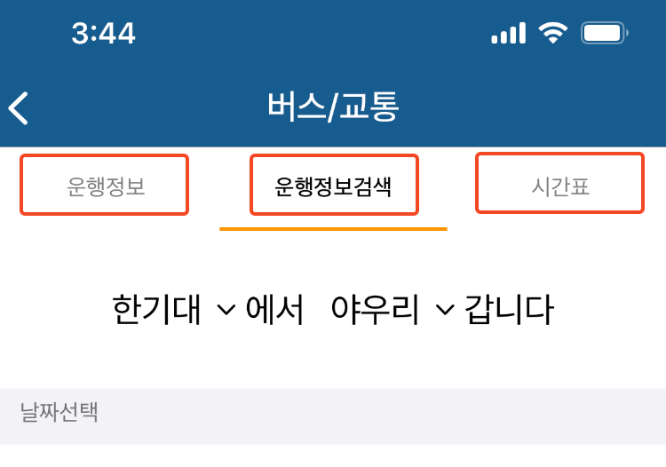

# [레거시] 3-1. (Android / iOS) 버스_탭 메뉴_클릭

> **레거시 문서** · 과거 구현과 로깅을 확인하기 위한 보존 자료입니다.

[← 버스 로깅 목록](README.md)

플랫폼: ANDROID · IOS  
원문 상태: 레거시

과거 로깅·새 로깅과 각 참고사진은 원문의 구간별 연결을 유지합니다.

원문 미기재 항목: `event_name`, `screen_view`. 값을 추정하지 않았습니다.

<!-- logging-section:past:start -->
## 과거 로깅

- event\_label : “bus\_tab\_menu”
- value : “운행정보 / 운행정보검색 / 시간표<b>”</b>
- event\_category : “click”

<!-- logging-section:past:end -->

<!-- logging-section:new:start -->
## 새 로깅

- 레거시: 현재 앱에 운행정보 / 운행정보검색 / 시간표 탭이 없어 새 로깅을 만들지 않는다. 셔틀/대성/시내 탭은 4-4. 버스 종류 탭\_클릭에서 다룬다.

웹 — 해당 없음 (레거시)

모바일 — 해당 없음 (레거시)

<!-- logging-section:new:end -->

---

원문 정보

원본 ID: `4670221954bc83659a1d81cb5dcdc3f8`  
[보존 원문](../../_archive/original/notion/pages/4670221954bc83659a1d81cb5dcdc3f8.md)

