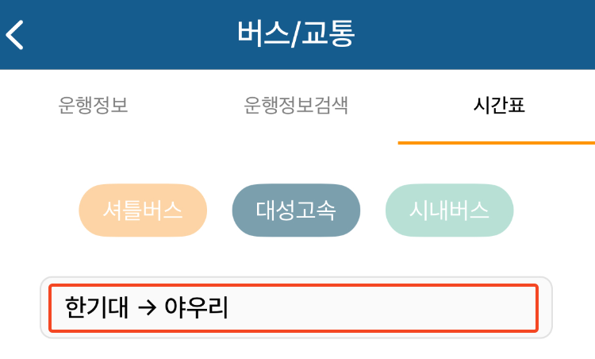
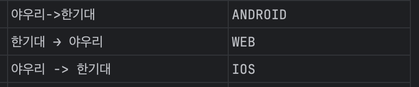

# [레거시] 3-10. 버스_시간표_대성고속_목적지_클릭

> **레거시 문서** · 과거 구현과 로깅을 확인하기 위한 보존 자료입니다.

[← 버스 로깅 목록](README.md)

플랫폼: ANDROID · IOS · WEB  
원문 상태: 레거시

과거 로깅·새 로깅과 각 참고사진은 원문의 구간별 연결을 유지합니다.

원문 미기재 항목: `event_name`, `screen_view`. 값을 추정하지 않았습니다.

<!-- logging-section:past:start -->
## 과거 로깅

- event\_label : “bus\_timetable\_express”
- value : “OOO → OOO<b>”</b>
  - 한기대 → 야우리, 야우리 → 한기대
- event\_category : “click”

---

(Android, iOS 재로깅 부탁드립니다)

<code>bus_timetable_express</code>

현재 로깅되어있는 value값이 각각 달라,

<u>value : ‘OOO → OOO’ 으로 Web과 통일 필요</u>

<!-- logging-section:past:end -->

<!-- logging-section:new:start -->
## 새 로깅

- 레거시: 지금 앱에 없는 화면(구 시간표의 대성고속 목적지 선택)이라 새 로깅을 만들지 않는다.
- 대체 로깅: 4-9. 대성버스 운행방면\_클릭 (<code>bus__bus_timetable__filter__daeseong_direction__select</code>)

웹 — 해당 없음 (레거시)

모바일 — 해당 없음 (레거시)

<!-- logging-section:new:end -->

---

원문 정보

원본 ID: `47f0221954bc827ea02e01dd1c799b62`  
[보존 원문](../../_archive/original/notion/pages/47f0221954bc827ea02e01dd1c799b62.md)

