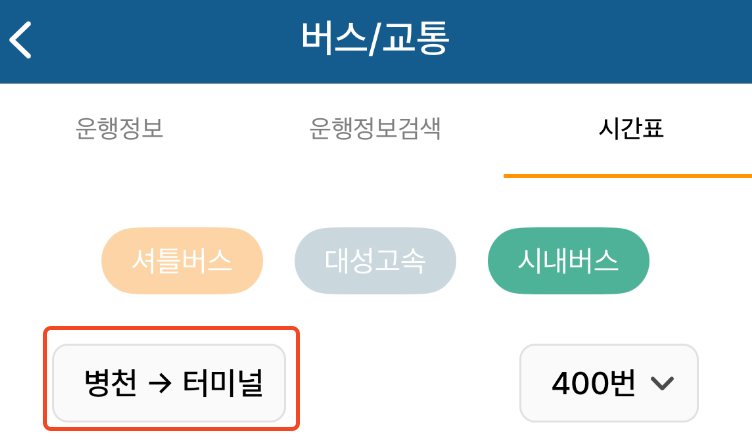

# 3-11. 버스_시간표_시내버스_목적지_클릭

[← 버스 목록](README.md)

플랫폼: ANDROID, IOS, WEB  
원문 상태: 레거시  
[Notion 기준 명세](https://app.notion.com/p/9ad0221954bc823cbf5781cc98e20226)  
원본 ID: `9ad0221954bc823cbf5781cc98e20226`

<!-- notion-body:start -->
## 과거 로깅

- event\_label : “bus\_timetable\_citybus”
- value : “OOO → OOO<b>”</b>
  - 병천 → 터미널, 터미널 → 병천
- event\_category : “click”
- 참고사진



## 새 로깅

- 레거시: 지금 앱에 없는 화면(구 시간표의 시내버스 목적지 선택)이라 새 로깅을 만들지 않는다.
- 대체 로깅: 4-11. 시내버스 운행방면\_클릭 (<code>bus__bus_timetable__filter__city_direction__select</code>)

### 참고사진 (기능 표시)

<b>웹</b>

<b>참고사진 · 웹</b>

웹 — 해당 없음 (레거시)

<b>모바일</b>

<b>참고사진 · 모바일</b>

모바일 — 해당 없음 (레거시)
<!-- notion-body:end -->

<details>
<summary>Notion 원문 속성 전체</summary>

```json
{
  "platform": [
    "ANDROID",
    "IOS",
    "WEB"
  ],
  "url": "https://app.notion.com/p/9ad0221954bc823cbf5781cc98e20226",
  "구분": "시간표 (WEB / Android / iOS)",
  "상태": "레거시",
  "생성일": "2026-11-23T13:38:33.053Z",
  "이벤트 이름": "3-11. 버스\\_시간표\\_시내버스\\_목적지\\_클릭",
  "태그": [
    "3. 버스/교통 상세 페이지"
  ]
}
```

</details>
