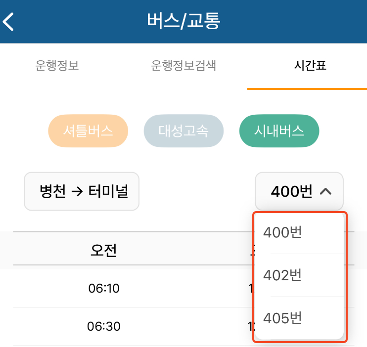

# [레거시] 3-12. 버스_시간표_시내버스_버스 번호_클릭

> **레거시 문서** · 과거 구현과 로깅을 확인하기 위한 보존 자료입니다.

[← 버스 로깅 목록](README.md)

플랫폼: ANDROID · IOS · WEB  
원문 상태: 레거시

과거 로깅·새 로깅과 각 참고사진은 원문의 구간별 연결을 유지합니다.

원문 미기재 항목: `event_name`, `screen_view`. 값을 추정하지 않았습니다.

<!-- logging-section:past:start -->
## 과거 로깅

- event\_label : “bus\_timetable\_citybus\_route”
- value : “OOO번<b>”</b>
  - 400번, 402번, 405번
- event\_category : “click”

<!-- logging-section:past:end -->

<!-- logging-section:new:start -->
## 새 로깅

- 레거시: 지금 앱에 없는 화면(구 시간표의 시내버스 번호 선택)이라 새 로깅을 만들지 않는다.
- 대체 로깅: 4-10. 시내버스 노선\_클릭 (<code>bus__bus_timetable__filter__city_route__select</code>)

웹 — 해당 없음 (레거시)

모바일 — 해당 없음 (레거시)

<!-- logging-section:new:end -->

---

원문 정보

원본 ID: `4db0221954bc8204895c0159c27264c5`  
[보존 원문](../../_archive/original/notion/pages/4db0221954bc8204895c0159c27264c5.md)

