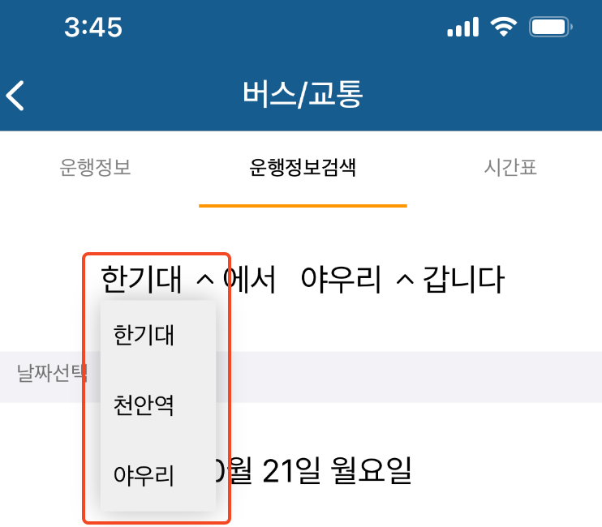

# [레거시] 3-4. (Android / iOS) 버스_운행정보검색_출발지_클릭

> **레거시 문서** · 과거 구현과 로깅을 확인하기 위한 보존 자료입니다.

[← 버스 로깅 목록](README.md)

플랫폼: ANDROID · IOS  
원문 상태: 레거시

과거 로깅·새 로깅과 각 참고사진은 원문의 구간별 연결을 유지합니다.

원문 미기재 항목: `event_name`, `screen_view`. 값을 추정하지 않았습니다.

<!-- logging-section:past:start -->
## 과거 로깅

# <b>운행정보검색 (Android / iOS)</b>

- event\_label : “bus\_search\_departure”
- value : “한기대 / 천안역 / 야우리<b>”</b>
- event\_category : “click”

<!-- logging-section:past:end -->

<!-- logging-section:new:start -->
## 새 로깅

- 레거시: 지금 앱에 없는 화면(운행정보검색 탭)이라 새 로깅을 만들지 않는다.
- 대체 로깅: 5-2. 출발지\_확인\_클릭 (<code>bus__bus_search__search__departure_confirm__select</code>)

웹 — 해당 없음 (레거시)

모바일 — 해당 없음 (레거시)

<!-- logging-section:new:end -->

---

원문 정보

원본 ID: `fdb0221954bc83ce86cb01bb22d7b8c5`  
[보존 원문](../../_archive/original/notion/pages/fdb0221954bc83ce86cb01bb22d7b8c5.md)

