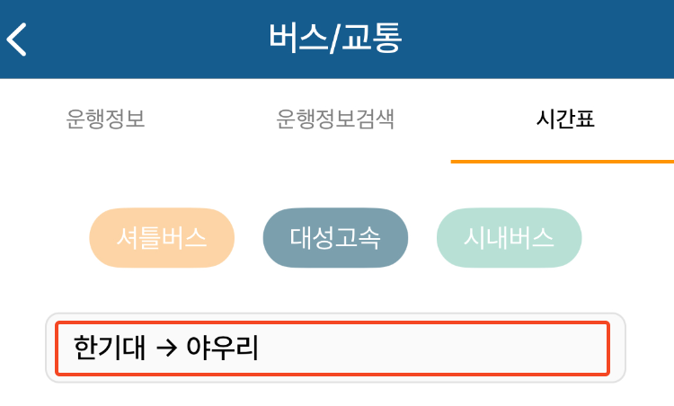

# 3-9. 버스_시간표_학교셔틀_시간&장소_클릭

[← 버스 로깅 목록](README.md)

플랫폼: ANDROID · IOS · WEB  
원문 상태: 레거시

과거 로깅·새 로깅과 각 참고사진은 원문의 구간별 연결을 유지합니다.

원문 미기재 항목: `event_name`, `screen_view`. 값을 추정하지 않았습니다.

생성일: 2026년 11월 12일 오후 2:07
태그: 3. 버스/교통 상세 페이지
platform: ANDROID, IOS, WEB
구분: 시간표 (WEB / Android / iOS)
상태: 레거시

<!-- logging-section:past:start -->
## 과거 로깅

- event\_label : “bus\_timetable\_time”
- value : “\{드롭다운 목록\}<b>”</b>
- event\_category : “click”
- 참고사진

---

(web만 재로깅 부탁드립니다)

웹의 경우 event\_label이 “bus\_timetable\_shuttle\_route”으로 로깅되어 있어 안드, iOS와 상이합니다. event\_label : “bus\_timetable\_shuttle\_route” → “<u>bus\_timetable\_time”</u>로 변경 부탁드립니다.

<!-- logging-section:past:end -->

<!-- logging-section:new:start -->
## 새 로깅

- 레거시: 지금 앱에 없는 화면(구 시간표의 학교셔틀 드롭다운)이라 새 로깅을 만들지 않는다.
- 대체 로깅: 4-6. 지역별 세부 노선\_클릭 (`bus__bus_timetable__shuttle_route__entry__click`)

### 참고사진 (기능 표시)

<b>웹</b>

<b>참고사진 · 웹</b>

웹 — 해당 없음 (레거시)

<b>모바일</b>

<b>참고사진 · 모바일</b>

모바일 — 해당 없음 (레거시)

<!-- logging-section:new:end -->

---

원문 정보

원본 ID: `1c50221954bc8272bc980115492da6db`  
[보존 원문](../../_archive/original/notion/pages/1c50221954bc8272bc980115492da6db.md)

