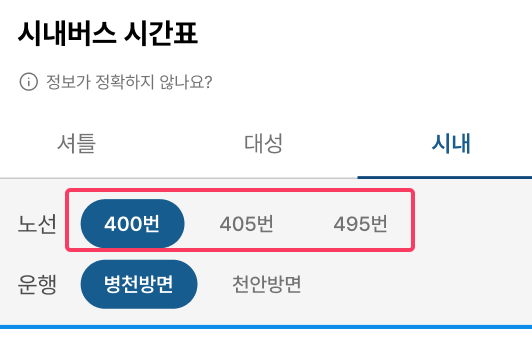
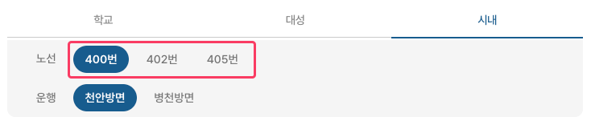
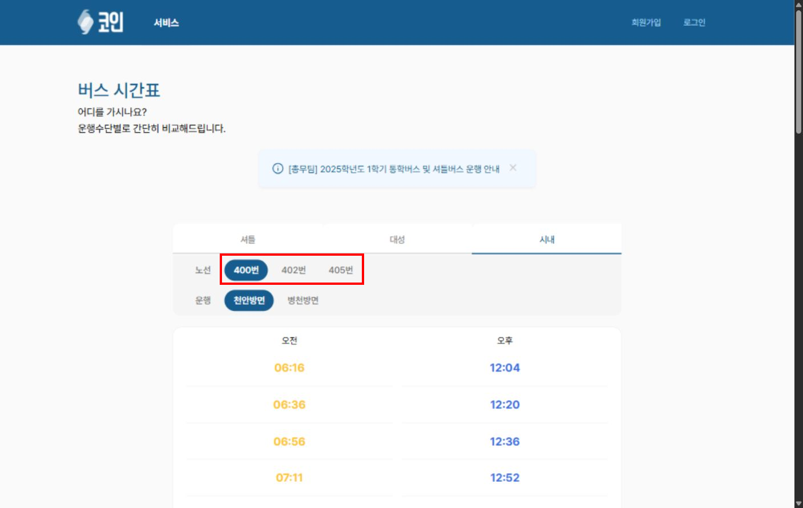
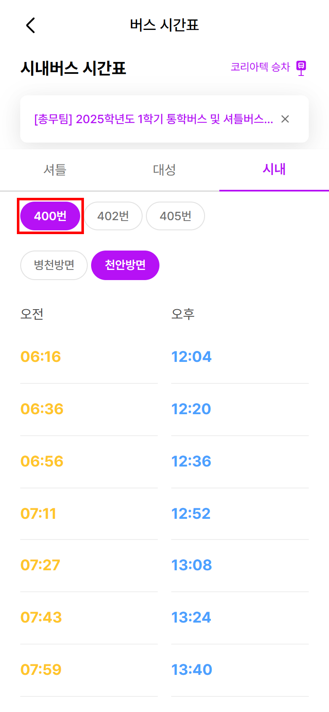

# 4-10. 시내버스 노선_클릭

[← 버스 로깅 목록](README.md)

플랫폼: ANDROID · IOS · WEB  
원문 상태: 완료

과거 로깅·새 로깅과 각 참고사진은 원문의 구간별 연결을 유지합니다.

<!-- logging-section:past:start -->
## 과거 로깅

- event\_label : “city\_bus\_route”
- value : “OOO번<b>”</b>
  - 400, 405, 495 (24-12-15 기준)
- event\_category : “click”
- 참고사진

AND, IOS, WEB(Mobile view)

WEB

<!-- logging-section:past:end -->

<!-- logging-section:new:start -->
## 새 로깅

- 설명: 버스 시간표 화면 시내 탭에서 버스 노선 번호를 선택하는 경우
- screen\_view: <code>bus_timetable</code>
- event\_name: <code>DA1</code>
- event\_label: <code>bus__bus_timetable__filter__city_route__select</code>
- value: \{버스 번호\}번 (예: 400번, 405번, 495번)
- event\_category: <code>select</code>

### 참고사진 (기능 표시)

<b>웹</b>

<b>참고사진 · 웹</b>

WEB · 빨간 네모: 시내버스 노선 번호 선택. stage 실제 화면 캡처에 위치 표시.

<b>모바일</b>

<b>참고사진 · 모바일</b>

모바일 — 시내버스 노선 선택 (출처: stage 실제 캡처, 빨간 네모 = 클릭 위치)

<!-- logging-section:new:end -->

---

원문 정보

원본 ID: `7140221954bc83e2905e017ba3738a56`  
[보존 원문](../../_archive/original/notion/pages/7140221954bc83e2905e017ba3738a56.md)

