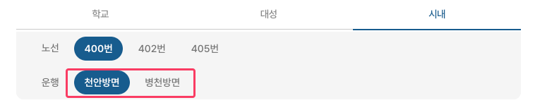
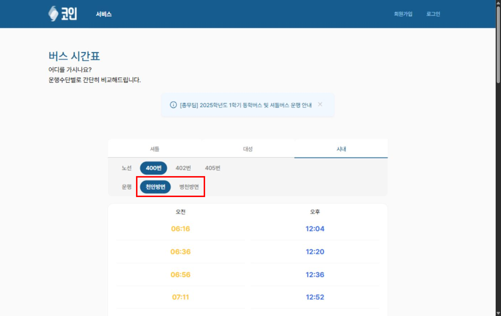
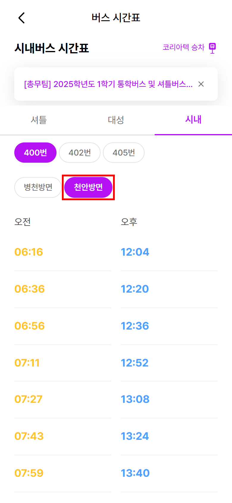

# 4-11. 시내버스 운행방면_클릭

[← 버스 목록](README.md)

플랫폼: ANDROID, IOS, WEB  
원문 상태: 완료  
[Notion 기준 명세](https://app.notion.com/p/bf30221954bc839689638190893fd5d2)  
원본 ID: `bf30221954bc839689638190893fd5d2`

<!-- notion-body:start -->
## 과거 로깅

- event\_label : “city\_bus\_direction”
- value : “병천방면<b>”, “천안방면”</b>
- event\_category : “click”
- 참고사진


AND, IOS, WEB(Mobile view)


WEB

## 새 로깅

- 설명: 버스 시간표 화면 시내 탭에서 운행 방면(병천방면 / 천안방면)을 선택하는 경우
- screen\_view: <code>bus_timetable</code>
- event\_name: <code>DA1</code>
- event\_label: <code>bus__bus_timetable__filter__city_direction__select</code>
- value: 병천방면 / 천안방면 (예: 병천방면)
- event\_category: <code>select</code>

### 참고사진 (기능 표시)

<b>웹</b>

<b>참고사진 · 웹</b>


WEB · 빨간 네모: 시내버스 운행방면 선택. stage 실제 화면 캡처에 위치 표시.

<b>모바일</b>

<b>참고사진 · 모바일</b>

모바일 — 시내 운행방면 선택 (출처: stage 실제 캡처, 빨간 네모 = 클릭 위치)


<!-- notion-body:end -->

<details>
<summary>Notion 원문 속성 전체</summary>

```json
{
  "platform": [
    "ANDROID",
    "IOS",
    "WEB"
  ],
  "url": "https://app.notion.com/p/bf30221954bc839689638190893fd5d2",
  "구분": "시내버스 시간표",
  "상태": "완료",
  "생성일": "2026-11-23T13:38:27.193Z",
  "이벤트 이름": "4-11. 시내버스 운행방면\\_클릭",
  "태그": [
    "4. 버스 시간표"
  ]
}
```

</details>
