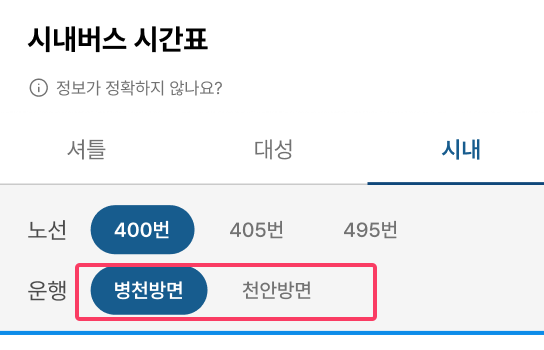

# 4-11. 시내버스 운행방면_클릭

[← 버스 로깅 목록](README.md)

플랫폼: ANDROID · IOS · WEB  
원문 상태: 완료

과거 로깅·새 로깅과 각 참고사진은 원문의 구간별 연결을 유지합니다.

<!-- logging-section:past:start -->
## 과거 로깅

- event\_label : “city\_bus\_direction”
- value : “병천방면<b>”, “천안방면”</b>
- event\_category : “click”

AND, IOS, WEB(Mobile view)

WEB

<!-- logging-section:past:end -->

<!-- logging-section:new:start -->
## 새 로깅

- 설명: 버스 시간표 화면 시내 탭에서 운행 방면(병천방면 / 천안방면)을 선택하는 경우
- screen\_view: <code>bus_timetable</code>
- event\_name: <code>DA1</code>
- event\_label: <code>bus__bus_timetable__filter__city_direction__select</code>
- value: 병천방면 / 천안방면 (예: 병천방면)
- event\_category: <code>select</code>

### 참고사진 (기능 표시)

#### 웹

WEB · 빨간 네모: 시내버스 운행방면 선택. stage 실제 화면 캡처에 위치 표시.

#### 모바일

모바일 — 시내 운행방면 선택 (출처: stage 실제 캡처, 빨간 네모 = 클릭 위치)

<!-- logging-section:new:end -->

---

원문 정보

원본 ID: `f050221954bc83c488ca81e85b85af1c`  
[보존 원문](../../_archive/original/notion/pages/f050221954bc83c488ca81e85b85af1c.md)

