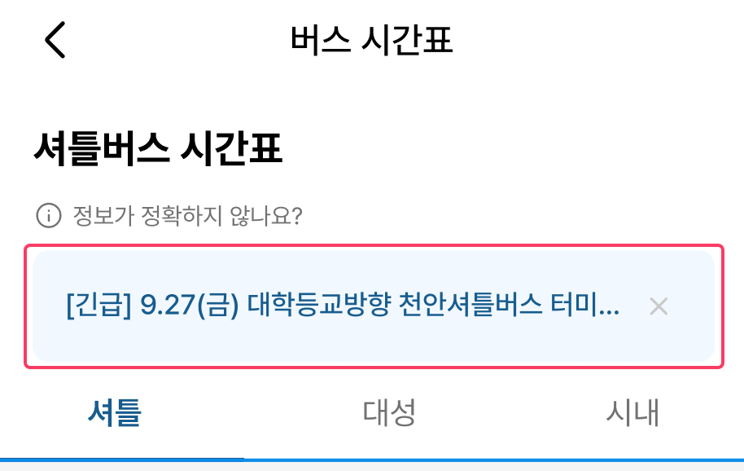
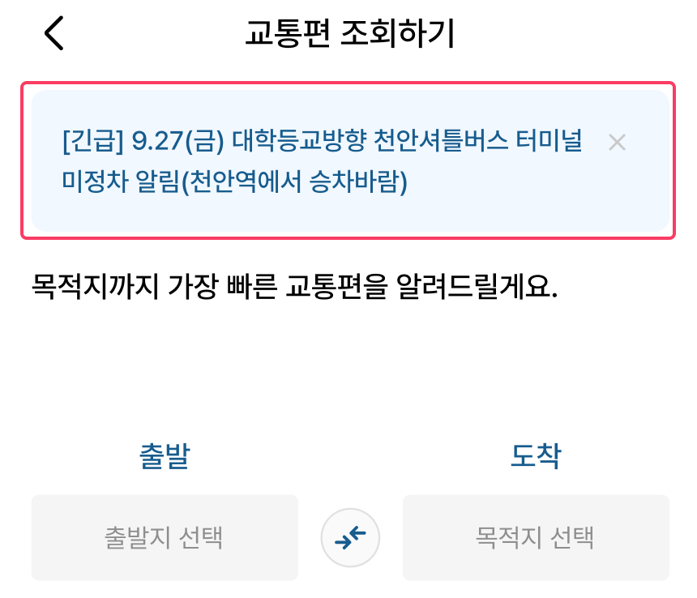
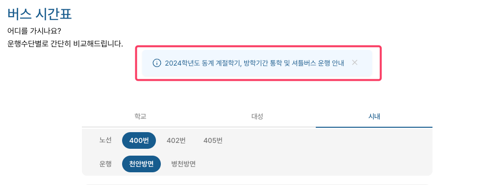
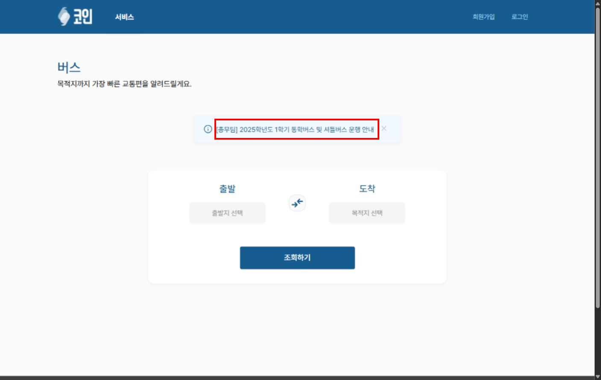
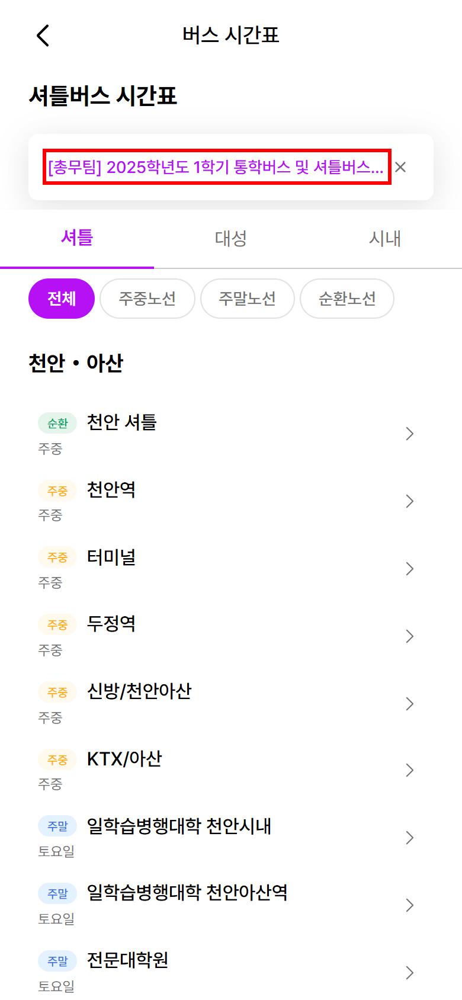

# 4-2. 버스 공지_클릭

[← 버스 목록](README.md)

플랫폼: ANDROID, IOS, WEB  
원문 상태: 로깅 필요  
[Notion 기준 명세](https://app.notion.com/p/59d0221954bc82fb8d8081c3dc394b37)  
원본 ID: `59d0221954bc82fb8d8081c3dc394b37`

<!-- notion-body:start -->
## 과거 로깅

- 기능 설명 : <code>통학버스</code>, <code>셔틀버스</code>, <code>셔틀</code> 키워드가 포함된 가장 최근의 공지
- event\_label : “bus\_announcement”
- value : <b>이 버튼을 누른 위치</b>
  - “셔틀버스 시간표”, “대성버스 시간표”, “시내버스 시간표”
  - “교통편 조회하기”
- event\_category : “click”
- 참고사진




AND, IOS, WEB(Mobile view)


WEB

## 새 로깅

- 설명: 버스 시간표 화면 또는 버스 교통편 화면 상단의 버스 공지를 클릭하는 경우
- screen\_view: <code>bus_timetable</code>
- event\_name: <code>DA1</code>
- event\_label: <code>bus__bus_timetable__bus_notice__open__click</code>
- value: 셔틀 / 대성 / 시내 (시간표 화면, 보고 있던 탭) · 버스 교통편 (교통편 화면) (예: 시간표 화면 → 셔틀, 교통편 화면 → 버스 교통편)
- event\_category: <code>click</code>

### 참고사진 (기능 표시)

<b>웹</b>

<b>참고사진 · 웹</b>


WEB · 빨간 네모: 버스 공지 본문 클릭. stage 실제 화면 캡처에 위치 표시.

<b>모바일</b>

<b>참고사진 · 모바일</b>

모바일 — 버스 공지 클릭, 시간표 화면 (bus\_timetable) (출처: stage 실제 캡처, 빨간 네모 = 클릭 위치)



파란색 구버전 모바일 사진 제거 (2026-10-30).
<!-- notion-body:end -->

<details>
<summary>Notion 원문 속성 전체</summary>

```json
{
  "platform": [
    "ANDROID",
    "IOS",
    "WEB"
  ],
  "url": "https://app.notion.com/p/59d0221954bc82fb8d8081c3dc394b37",
  "상태": "로깅 필요",
  "생성일": "2026-11-23T13:38:30.254Z",
  "이벤트 이름": "4-2. 버스 공지\\_클릭",
  "태그": [
    "4. 버스 시간표"
  ]
}
```

</details>
