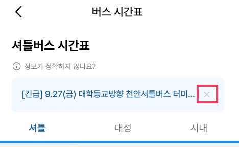
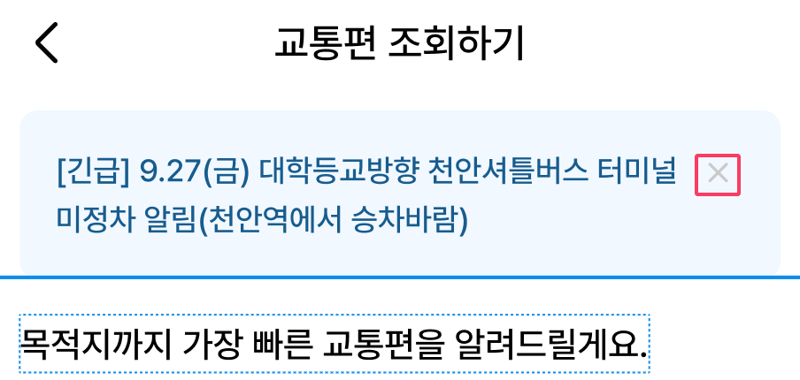
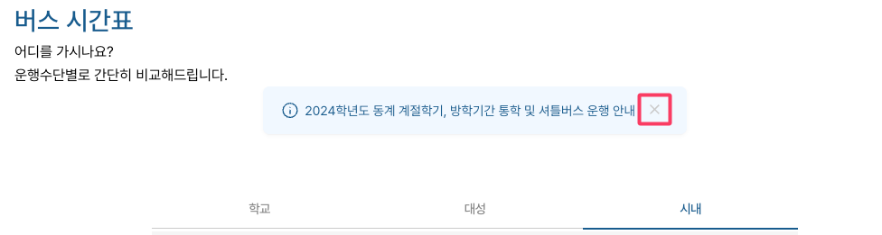
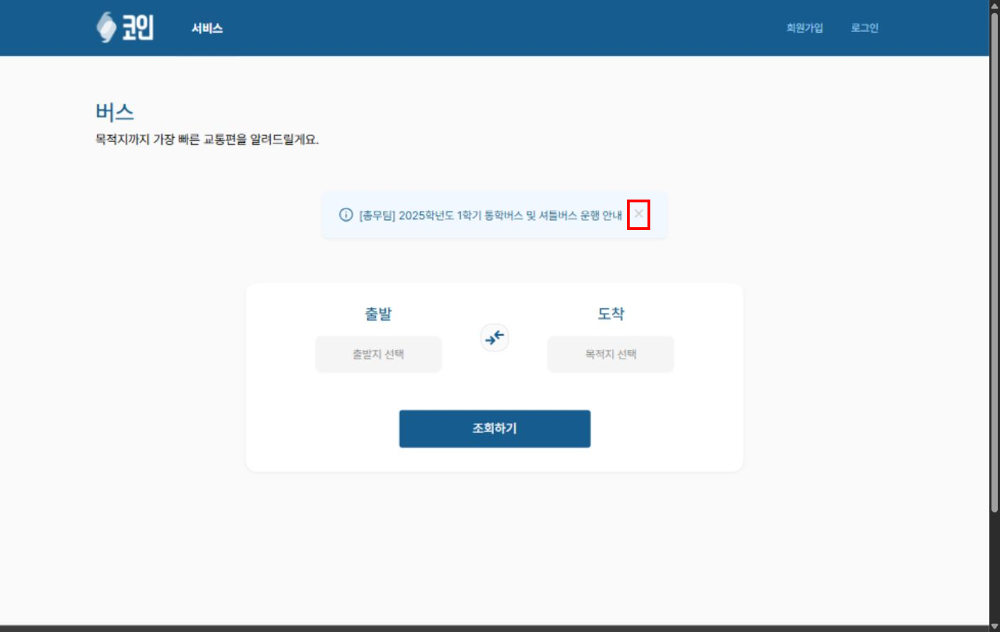
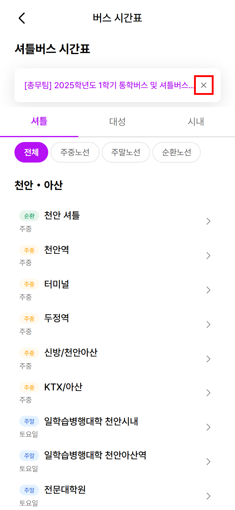

# 4-3. 버스 공지_닫기_클릭

[← 버스 로깅 목록](README.md)

플랫폼: ANDROID · IOS · WEB  
원문 상태: 로깅 필요

과거 로깅·새 로깅과 각 참고사진은 원문의 구간별 연결을 유지합니다.

<!-- logging-section:past:start -->
## 과거 로깅

- event\_label : “bus\_announcement\_close”
- value : <b>이 버튼을 누른 위치</b>
  - “셔틀버스 시간표”, “대성버스 시간표”, “시내버스 시간표”
  - “교통편 조회하기”
- event\_category : “click”
- 참고사진

AND, IOS, WEB(Mobile view)

WEB

<!-- logging-section:past:end -->

<!-- logging-section:new:start -->
## 새 로깅

- 설명: 버스 시간표 화면 또는 버스 교통편 화면 상단의 버스 공지에서 X(닫기)를 클릭하는 경우
- screen\_view: <code>bus_timetable</code>
- event\_name: <code>DA1</code>
- event\_label: <code>bus__bus_timetable__bus_notice__close__click</code>
- value: 셔틀 / 대성 / 시내 (시간표 화면, 보고 있던 탭) · 버스 교통편 (교통편 화면) (예: 시간표 화면 → 셔틀, 교통편 화면 → 버스 교통편)
- event\_category: <code>click</code>

### 참고사진 (기능 표시)

<b>웹</b>

<b>참고사진 · 웹</b>

WEB · 빨간 네모: 버스 공지 X 닫기. stage 실제 화면 캡처에 위치 표시.

<b>모바일</b>

<b>참고사진 · 모바일</b>

모바일 — 버스 공지 닫기, 시간표 화면 (bus\_timetable) (출처: stage 실제 캡처, 빨간 네모 = 클릭 위치)

파란색 구버전 모바일 사진 제거 (2026-10-30).

<!-- logging-section:new:end -->

---

원문 정보

원본 ID: `9520221954bc826a8fe48121ece4ba21`  
[보존 원문](../../_archive/original/notion/pages/9520221954bc826a8fe48121ece4ba21.md)

