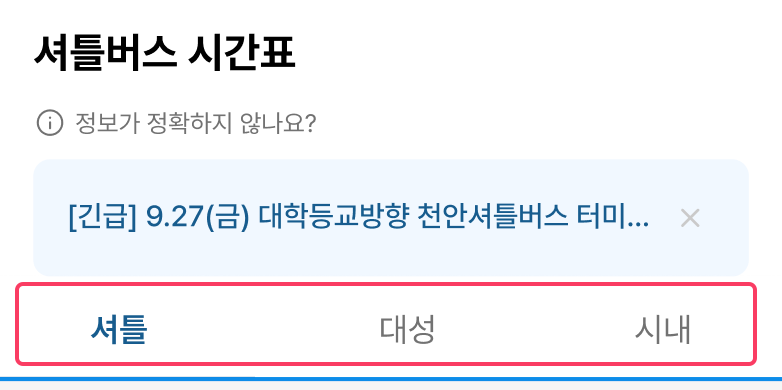
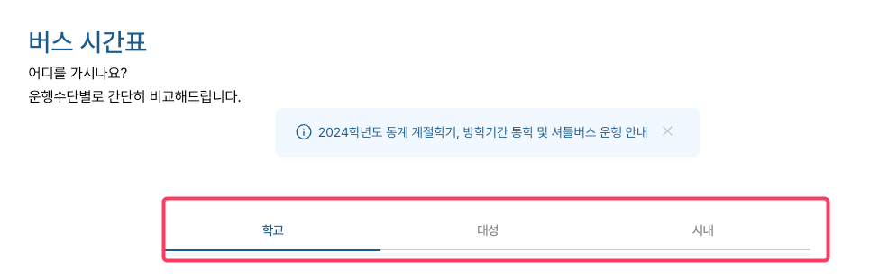
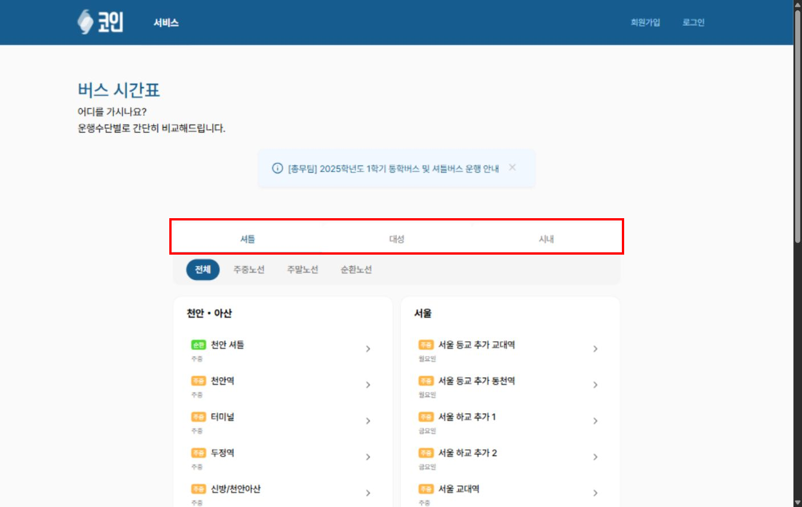
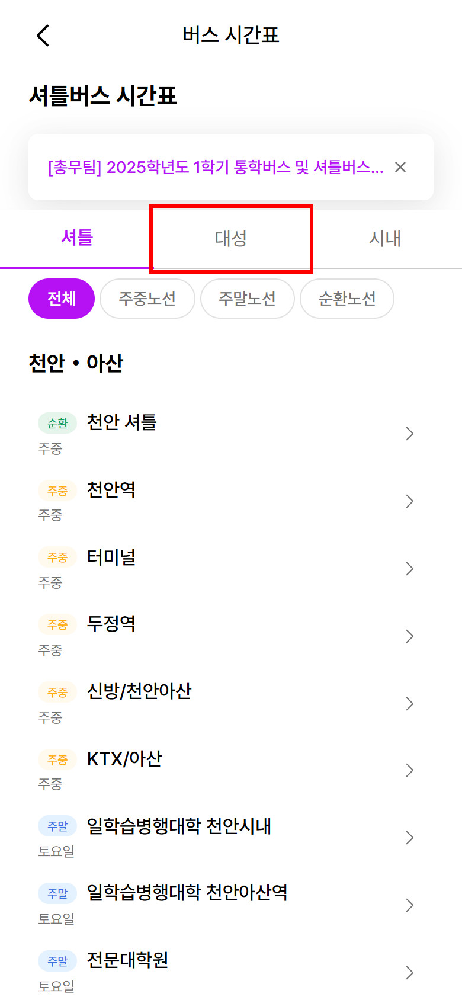

# 4-4. 버스 종류 탭_클릭

[← 버스 목록](README.md)

플랫폼: ANDROID, IOS, WEB  
원문 상태: 로깅 필요  
[Notion 기준 명세](https://app.notion.com/p/07b0221954bc82068ad9019b66293079)  
원본 ID: `07b0221954bc82068ad9019b66293079`

<!-- notion-body:start -->
## 과거 로깅

- event\_label : “timetable\_bus\_type\_tab”
- value : “셔틀<b>”, “대성”, “시내”</b>
  - WEB의 경우에도 로깅 시 “학교” 대신 “<b>셔틀</b>”로 부탁드립니다
- event\_category : “click”
- 참고사진


AND, IOS, WEB(Mobile view)


WEB

## 새 로깅

- 설명: 버스 시간표 화면에서 버스 종류 탭(셔틀 / 대성 / 시내)을 클릭하는 경우
- screen\_view: <code>bus_timetable</code>
- event\_name: <code>DA1</code>
- event\_label: <code>bus__bus_timetable__filter__bus_type__click</code>
- value: 셔틀 / 대성 / 시내 (WEB도 학교 대신 셔틀) (예: 셔틀)
- event\_category: <code>click</code>

### 참고사진 (기능 표시)

<b>웹</b>

<b>참고사진 · 웹</b>


WEB · 빨간 네모: 버스 종류 탭 클릭. stage 실제 화면 캡처에 위치 표시.

<b>모바일</b>

<b>참고사진 · 모바일</b>

모바일 — 버스 종류 탭 (출처: stage 실제 캡처, 빨간 네모 = 클릭 위치)


<!-- notion-body:end -->

<details>
<summary>Notion 원문 속성 전체</summary>

```json
{
  "platform": [
    "ANDROID",
    "IOS",
    "WEB"
  ],
  "url": "https://app.notion.com/p/07b0221954bc82068ad9019b66293079",
  "상태": "로깅 필요",
  "생성일": "2026-11-23T13:38:30.463Z",
  "이벤트 이름": "4-4. 버스 종류 탭\\_클릭",
  "태그": [
    "4. 버스 시간표"
  ]
}
```

</details>
