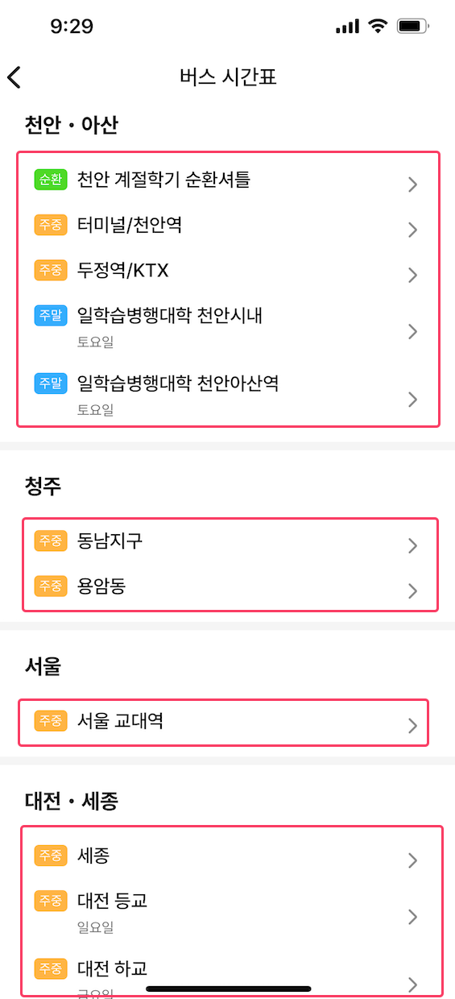
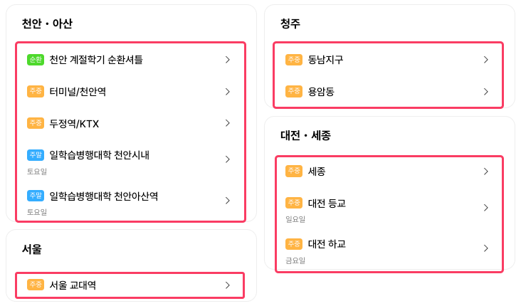
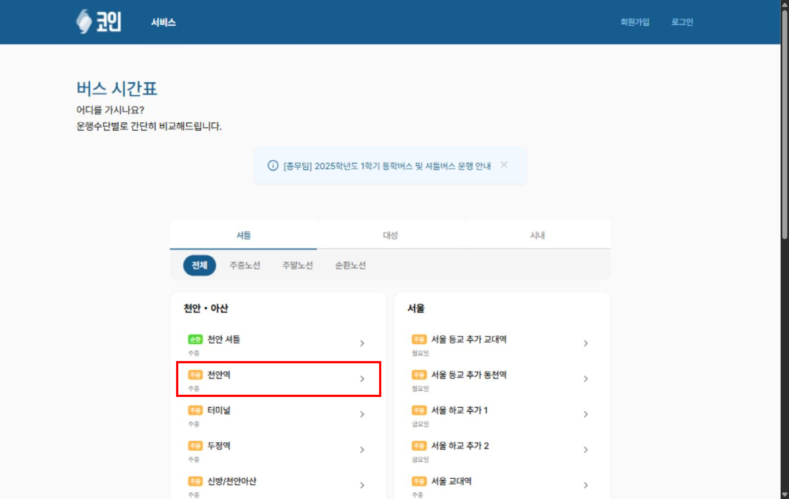
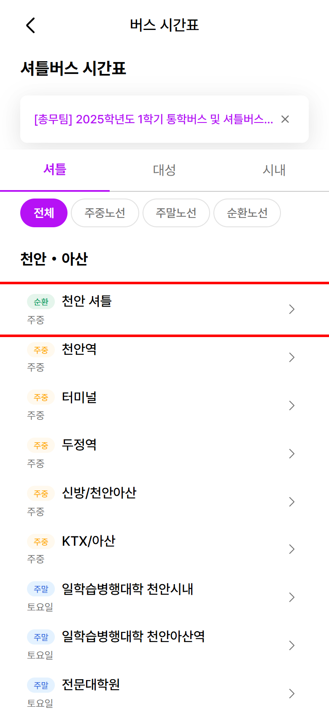

# 4-6. 지역별 세부 노선_클릭 (세부 노선 변경시 업데이트 필요)

[← 버스 목록](README.md)

플랫폼: ANDROID, IOS, WEB  
원문 상태: 로깅 필요  
[Notion 기준 명세](https://app.notion.com/p/4660221954bc8236ba5f811e009399ef)  
원본 ID: `4660221954bc8236ba5f811e009399ef`

<!-- notion-body:start -->
## 과거 로깅

- event\_label : “area\_specific\_route”
- value : (세부 노선 변경시 업데이트 필요)<br /><b>\{노선\_세부 노선\} 형식 </b>
  - “순환\_천안 계절학기 순환셔틀”, “주중\_터미널/천안역”, “주말\_일학습병행대학 천안시내” 등
- event\_category : “click”
- 참고사진


AND, IOS, WEB(Mobile view)


WEB

## 새 로깅

- 설명: 버스 시간표 화면 셔틀 탭에서 노선(예: 천안 셔틀)을 클릭해 셔틀버스 시간표 상세 화면으로 들어가는 경우
- screen\_view: <code>bus_timetable</code>
- event\_name: <code>DA1</code>
- event\_label: <code>bus__bus_timetable__shuttle_route__entry__click</code>
- value: \{노선 구분\}\_\{세부 노선\} (예: 순환\_천안 셔틀, 주중\_천안역)
- event\_category: <code>click</code>

### 참고사진 (기능 표시)

<b>웹</b>

<b>참고사진 · 웹</b>


WEB · 빨간 네모: 지역별 셔틀 노선 진입. stage 실제 화면 캡처에 위치 표시.

<b>모바일</b>

<b>참고사진 · 모바일</b>

모바일 — 지역별 세부 노선 클릭 (출처: stage 실제 캡처, 빨간 네모 = 클릭 위치)


<!-- notion-body:end -->

<details>
<summary>Notion 원문 속성 전체</summary>

```json
{
  "platform": [
    "ANDROID",
    "IOS",
    "WEB"
  ],
  "url": "https://app.notion.com/p/4660221954bc8236ba5f811e009399ef",
  "구분": "셔틀버스 시간표",
  "상태": "로깅 필요",
  "생성일": "2026-11-23T13:38:27.306Z",
  "이벤트 이름": "4-6. 지역별 세부 노선\\_클릭 (세부 노선 변경시 업데이트 필요)",
  "태그": [
    "4. 버스 시간표"
  ]
}
```

</details>
