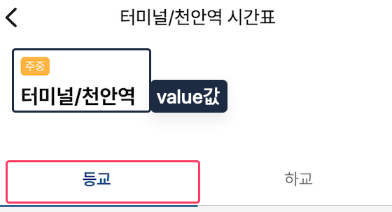
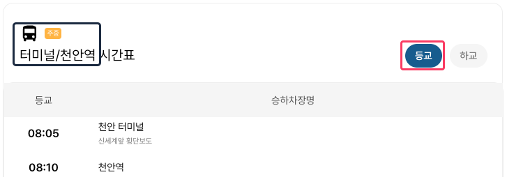
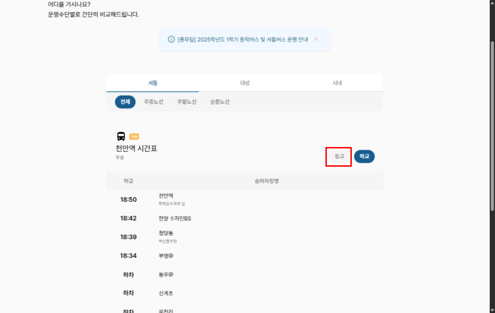
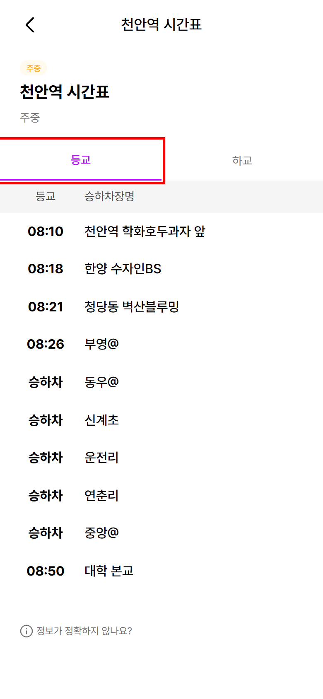

# 4-7. 셔틀버스_등교_클릭 (세부 노선 변경시 업데이트 필요)

[← 버스 로깅 목록](README.md)

플랫폼: ANDROID · IOS · WEB  
원문 상태: 로깅 필요

과거 로깅·새 로깅과 각 참고사진은 원문의 구간별 연결을 유지합니다.

<!-- logging-section:past:start -->
## 과거 로깅

- event\_label : “go\_to\_school”
- value : <b>이 버튼을 누른 위치 </b>(세부 노선 변경시 업데이트 필요)
  - “순환\_천안 계절학기 순환셔틀”, “주중\_터미널/천안역”, “주말\_일학습병행대학 천안시내” 등
- event\_category : “click”

AND, IOS, WEB(Mobile view)

WEB

<!-- logging-section:past:end -->

<!-- logging-section:new:start -->
## 새 로깅

- 설명: 셔틀버스 시간표 상세 화면에서 등교를 클릭하는 경우
- screen\_view: <code>bus_timetable_detail</code>
- event\_name: <code>DA1</code>
- event\_label: <code>bus__bus_timetable_detail__filter__to_school__click</code>
- value: \{노선 구분\}\_\{세부 노선\} (예: 주중\_천안역)
- event\_category: <code>click</code>

### 참고사진 (기능 표시)

#### 웹

WEB · 빨간 네모: 셔틀 상세 등교 선택. stage 실제 화면 캡처에 위치 표시.

#### 모바일

모바일 — 셔틀버스 등교 클릭 (출처: stage 실제 캡처, 빨간 네모 = 클릭 위치)

<!-- logging-section:new:end -->

---

원문 정보

원본 ID: `8ae0221954bc8266974081872f5dbe29`  
[보존 원문](../../_archive/original/notion/pages/8ae0221954bc8266974081872f5dbe29.md)

