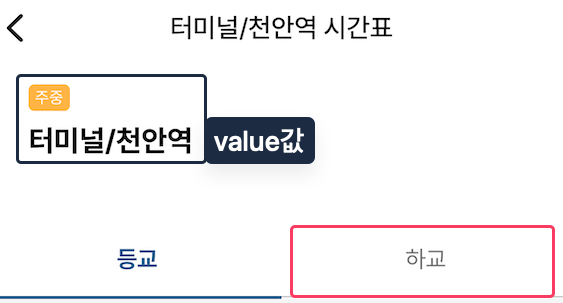
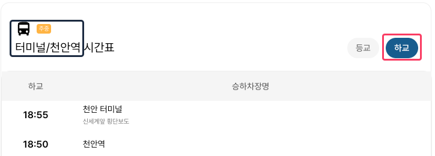
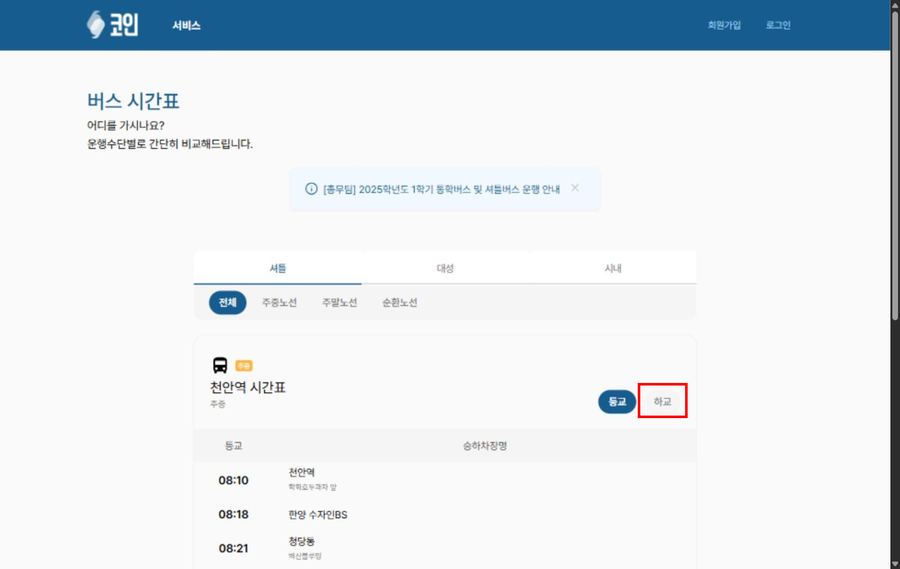
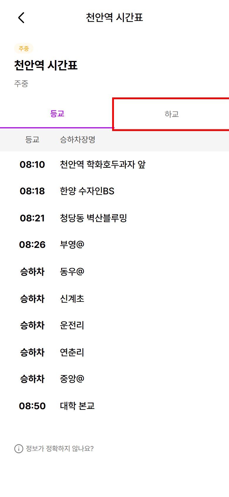

# 4-8. 셔틀버스_하교_클릭 (세부 노선 변경시 업데이트 필요)

[← 버스 목록](README.md)

플랫폼: ANDROID, IOS, WEB  
원문 상태: 로깅 필요  
[Notion 기준 명세](https://app.notion.com/p/59f0221954bc8354beb981c63ccfbf3e)  
원본 ID: `59f0221954bc8354beb981c63ccfbf3e`

<!-- notion-body:start -->
## 과거 로깅

- event\_label : “go\_home”
- value : <b>이 버튼을 누른 위치 </b>(세부 노선 변경시 업데이트 필요)
  - “순환\_천안 계절학기 순환셔틀”, “주중\_터미널/천안역”, “주말\_일학습병행대학 천안시내” 등
- event\_category : “click”
- 참고사진


AND, IOS, WEB(Mobile view)


WEB

## 새 로깅

- 설명: 셔틀버스 시간표 상세 화면에서 하교를 클릭하는 경우
- screen\_view: <code>bus_timetable_detail</code>
- event\_name: <code>DA1</code>
- event\_label: <code>bus__bus_timetable_detail__filter__to_home__click</code>
- value: \{노선 구분\}\_\{세부 노선\} (예: 주중\_천안역)
- event\_category: <code>click</code>

### 참고사진 (기능 표시)

<b>웹</b>

<b>참고사진 · 웹</b>


WEB · 빨간 네모: 셔틀 상세 하교 선택. stage 실제 화면 캡처에 위치 표시.

<b>모바일</b>

<b>참고사진 · 모바일</b>

모바일 — 셔틀버스 하교 클릭 (출처: stage 실제 캡처, 빨간 네모 = 클릭 위치)


<!-- notion-body:end -->

<details>
<summary>Notion 원문 속성 전체</summary>

```json
{
  "platform": [
    "ANDROID",
    "IOS",
    "WEB"
  ],
  "url": "https://app.notion.com/p/59f0221954bc8354beb981c63ccfbf3e",
  "구분": "셔틀버스 시간표",
  "상태": "로깅 필요",
  "생성일": "2026-11-23T13:38:30.192Z",
  "이벤트 이름": "4-8. 셔틀버스\\_하교\\_클릭 (세부 노선 변경시 업데이트 필요)",
  "태그": [
    "4. 버스 시간표"
  ]
}
```

</details>
