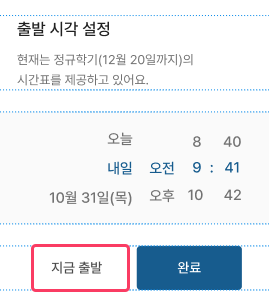
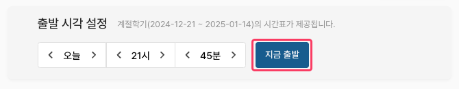
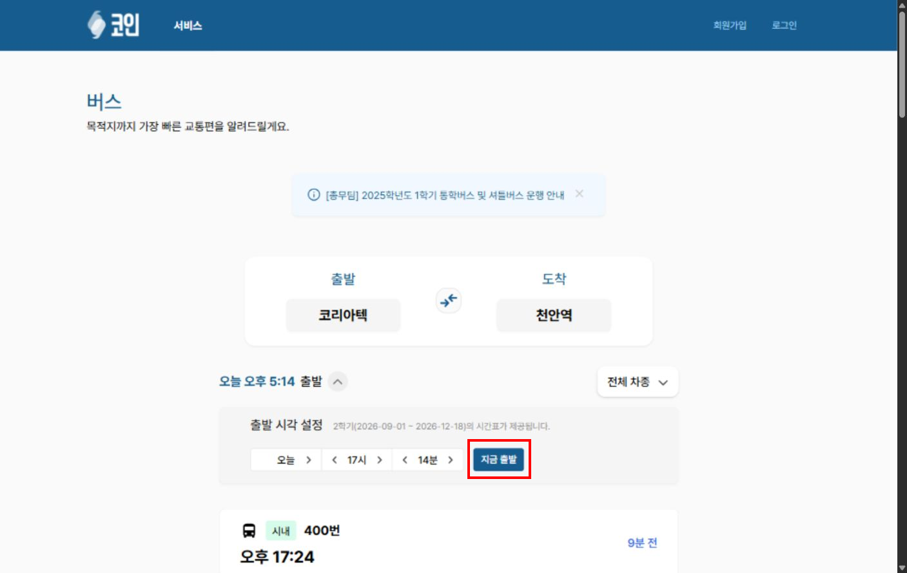
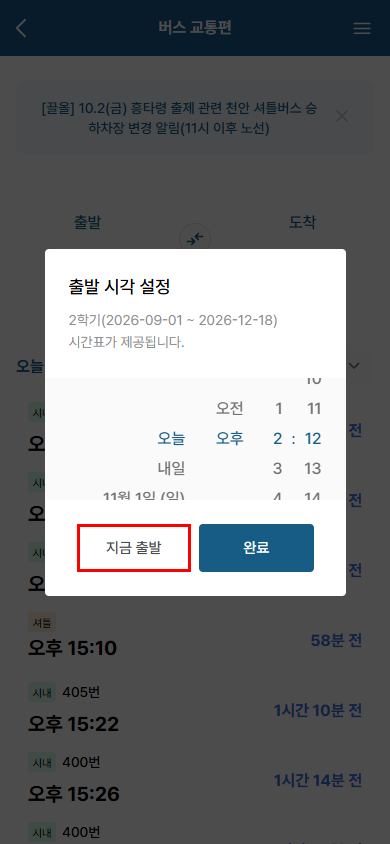

# 5-10. 지금 출발_클릭

[← 버스 목록](README.md)

플랫폼: ANDROID, IOS, WEB  
원문 상태: 완료  
[Notion 기준 명세](https://app.notion.com/p/2f20221954bc8203b60b8184d2a74302)  
원본 ID: `2f20221954bc8203b60b8184d2a74302`

<!-- notion-body:start -->
## 과거 로깅

- event\_label : “departure\_now”
- value : “지금 출발<b>”</b>
- event\_category : “click”
- 참고사진


AND, IOS, WEB(Mobile view)


WEB

---

- 분석 전 생각(DA)
  - 5-11에서 완료-시간설정: N와 동일한 이벤트라고 판단, 두 값의 COUNT와 완료-시간설정: Y의 COUNT를 비교해볼 수 있을듯

## 새 로깅

- 설명: 출발 시각 설정 창에서 지금 출발을 클릭하는 경우
- screen\_view: <code>bus_search_result</code>
- event\_name: <code>DA1</code>
- event\_label: <code>bus__bus_search_result__search__departure_time_now__click</code>
- value: 지금 출발
- event\_category: <code>click</code>

### 참고사진 (기능 표시)

<b>웹</b>

<b>참고사진 · 웹</b>


WEB · 빨간 네모: 출발 시각 설정의 지금출발 클릭. stage 실제 화면 캡처에 위치 표시.

<b>모바일</b>

<b>참고사진 · 모바일</b>


모바일 웹 · 운영 [https://koreatech.in/bus/route](https://koreatech.in/bus/route) 실제 파란색 화면을 2026-10-30에 캡처. 빨간 테두리: 출발 시간 설정 창의 지금 출발 버튼. Android/iOS 네이티브 앱 캡처가 아니며 SDK 발화·한 번 전송은 미확인.
<!-- notion-body:end -->

<details>
<summary>Notion 원문 속성 전체</summary>

```json
{
  "platform": [
    "ANDROID",
    "IOS",
    "WEB"
  ],
  "url": "https://app.notion.com/p/2f20221954bc8203b60b8184d2a74302",
  "구분": "출발 시각 설정",
  "상태": "완료",
  "생성일": "2026-11-23T13:38:32.523Z",
  "이벤트 이름": "5-10. 지금 출발\\_클릭",
  "태그": [
    "5. 교통편 조회하기"
  ]
}
```

</details>
