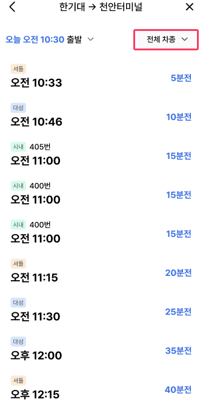
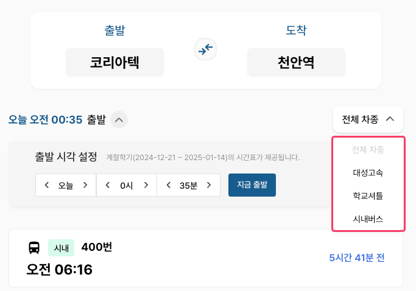
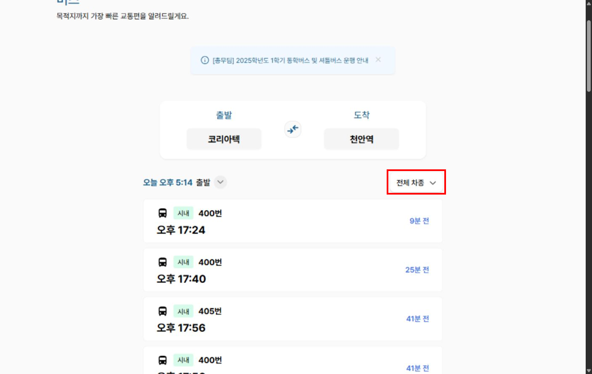
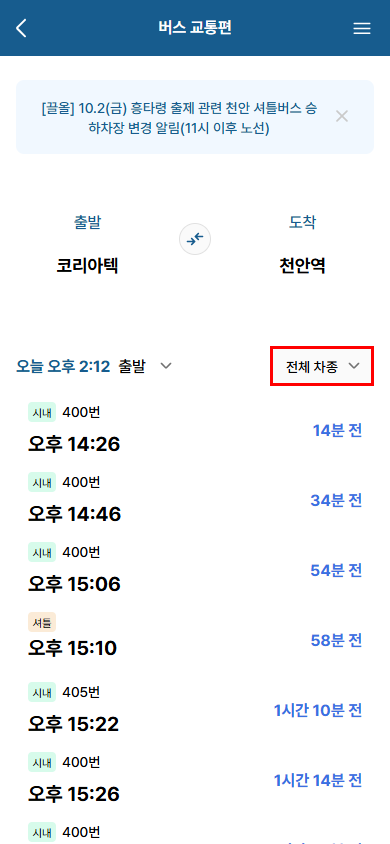

# 5-12. 교통편 차종_클릭

[← 버스 로깅 목록](README.md)

플랫폼: ANDROID · IOS · WEB  
원문 상태: 완료

과거 로깅·새 로깅과 각 참고사진은 원문의 구간별 연결을 유지합니다.

<!-- logging-section:past:start -->
## 과거 로깅

- event\_label : “search\_result\_bus\_type”
- value : “전체 차종<b>”, “셔틀”, “대성”, “시내”</b>
- event\_category : “click”
- 참고사진

AND, IOS, WEB(Mobile view)

WEB

<!-- logging-section:past:end -->

<!-- logging-section:new:start -->
## 새 로깅

- 설명: 교통편 조회 결과 화면에서 차종 필터(전체 차종 / 셔틀 / 대성 / 시내)를 선택하는 경우
- screen\_view: <code>bus_search_result</code>
- event\_name: <code>DA1</code>
- event\_label: <code>bus__bus_search_result__filter__bus_type__select</code>
- value: 전체 차종 / 셔틀 / 대성 / 시내 (예: 전체 차종)
- event\_category: <code>select</code>

### 참고사진 (기능 표시)

<b>웹</b>

<b>참고사진 · 웹</b>

WEB · 빨간 네모: 교통편 차종 필터 클릭. stage 실제 화면 캡처에 위치 표시.

<b>모바일</b>

<b>참고사진 · 모바일</b>

모바일 웹 · 운영 [https://koreatech.in/bus/route](https://koreatech.in/bus/route) 실제 파란색 화면을 2026-10-30에 캡처. 빨간 테두리: 전체 차종 필터 드롭다운. Android/iOS 네이티브 앱 캡처가 아니며 SDK 발화·한 번 전송은 미확인.

<!-- logging-section:new:end -->

---

원문 정보

원본 ID: `3900221954bc8347931a81a8080d396e`  
[보존 원문](../../_archive/original/notion/pages/3900221954bc8347931a81a8080d396e.md)

