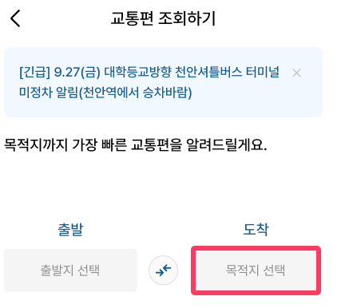
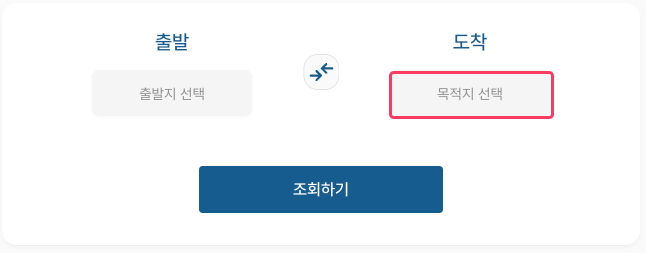
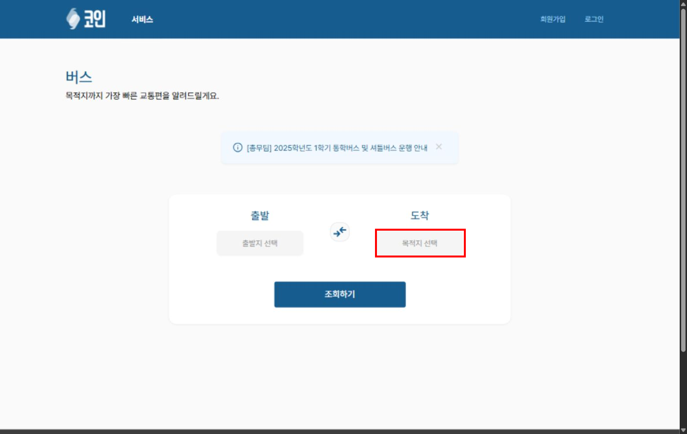
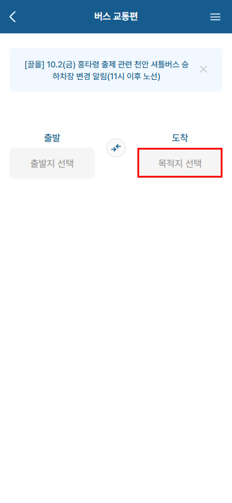

# 5-3. 도착지 박스_클릭

[← 버스 로깅 목록](README.md)

플랫폼: ANDROID · IOS · WEB  
원문 상태: 완료

과거 로깅·새 로깅과 각 참고사진은 원문의 구간별 연결을 유지합니다.

<!-- logging-section:past:start -->
## 과거 로깅

- event\_label : “arrival\_box”
- value : “목적지 선택”
- event\_category : “click”
- 참고사진

AND, IOS, WEB(Mobile view)

WEB

<!-- logging-section:past:end -->

<!-- logging-section:new:start -->
## 새 로깅

- 설명: 버스 교통편 화면에서 목적지 선택 박스를 클릭하는 경우
- screen\_view: <code>bus_search</code>
- event\_name: <code>DA1</code>
- event\_label: <code>bus__bus_search__search__arrival_open__click</code>
- value: 목적지 선택
- event\_category: <code>click</code>

### 참고사진 (기능 표시)

<b>웹</b>

<b>참고사진 · 웹</b>

WEB · 빨간 네모: 도착지 선택 박스 클릭. stage 실제 화면 캡처에 위치 표시.

<b>모바일</b>

<b>참고사진 · 모바일</b>

모바일 웹 · 운영 [https://koreatech.in/bus/route](https://koreatech.in/bus/route) 실제 파란색 화면을 2026-10-30에 캡처. 빨간 테두리: 목적지 선택 박스. Android/iOS 네이티브 앱 캡처가 아니며 SDK 발화·한 번 전송은 미확인.

<!-- logging-section:new:end -->

---

원문 정보

원본 ID: `62c0221954bc823e83bf81ac067e13f3`  
[보존 원문](../../_archive/original/notion/pages/62c0221954bc823e83bf81ac067e13f3.md)

