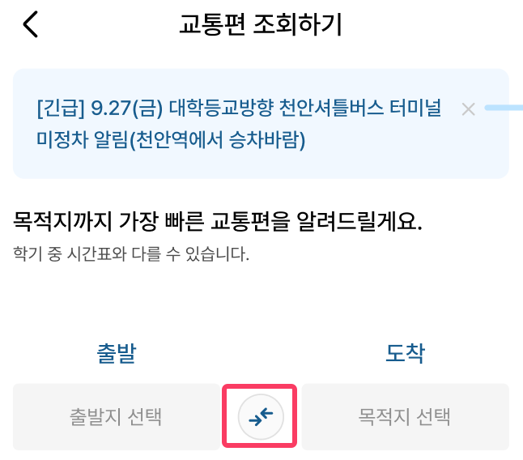
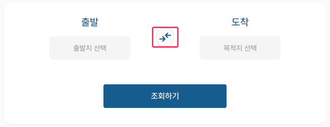

# 5-5. 출발지/도착지 변경_클릭

[← 버스 목록](README.md)

플랫폼: ANDROID, IOS, WEB  
원문 상태: 완료  
[Notion 기준 명세](https://app.notion.com/p/3910221954bc829fa2a0813f0c2a459c)  
원본 ID: `3910221954bc829fa2a0813f0c2a459c`

<!-- notion-body:start -->
## 과거 로깅

- event\_label : “swap\_destination”
- value : “스왑 버튼<b>”</b>
- event\_category : “click”
- 참고사진


AND, IOS, WEB(Mobile view)


WEB

## 새 로깅

- 설명: 버스 교통편 화면에서 출발지와 목적지를 서로 바꾸는 버튼을 클릭하는 경우
- screen\_view: <code>bus_search</code>
- event\_name: <code>DA1</code>
- event\_label: <code>bus__bus_search__search__swap__click</code>
- value: 출발지 도착지 바꾸기
- event\_category: <code>click</code>

### 참고사진 (기능 표시)

<b>웹</b>

<b>참고사진 · 웹</b>


WEB · 빨간 네모: 출발지·도착지 교환 버튼 클릭. stage 실제 화면 캡처에 위치 표시.

<b>모바일</b>

<b>참고사진 · 모바일</b>


모바일 웹 · 운영 [https://koreatech.in/bus/route](https://koreatech.in/bus/route) 실제 파란색 화면을 2026-10-30에 캡처. 빨간 테두리: 출발지와 도착지를 바꾸는 양방향 화살표. Android/iOS 네이티브 앱 캡처가 아니며 SDK 발화·한 번 전송은 미확인.
<!-- notion-body:end -->

<details>
<summary>Notion 원문 속성 전체</summary>

```json
{
  "platform": [
    "ANDROID",
    "IOS",
    "WEB"
  ],
  "url": "https://app.notion.com/p/3910221954bc829fa2a0813f0c2a459c",
  "상태": "완료",
  "생성일": "2026-11-23T13:38:32.737Z",
  "이벤트 이름": "5-5. 출발지/도착지 변경\\_클릭",
  "태그": [
    "5. 교통편 조회하기"
  ]
}
```

</details>
