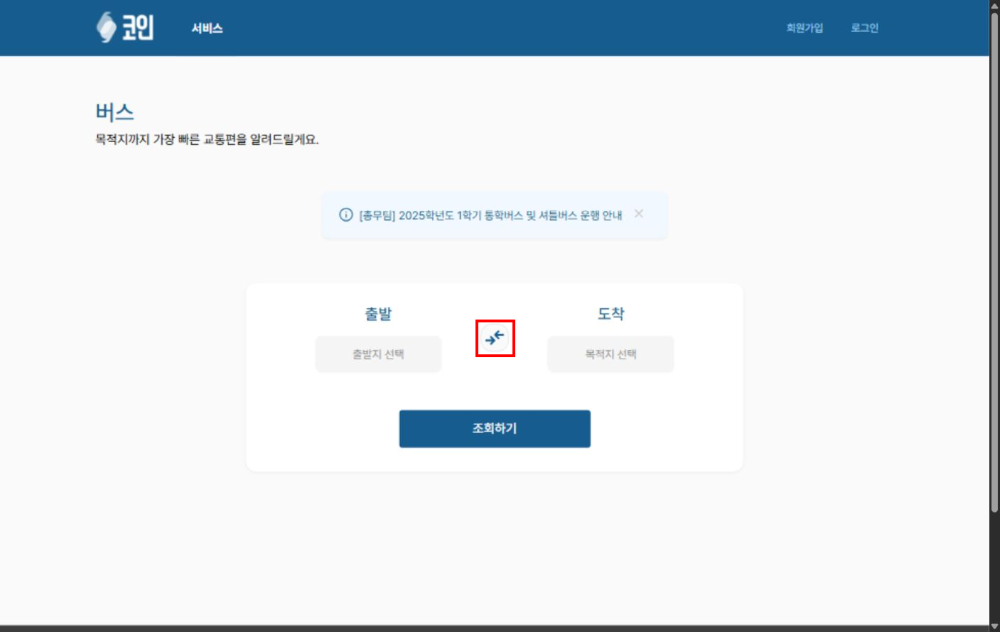

# 5-5. 출발지/도착지 변경_클릭

[← 버스 로깅 목록](README.md)

플랫폼: ANDROID · IOS · WEB  
원문 상태: 완료

과거 로깅·새 로깅과 각 참고사진은 원문의 구간별 연결을 유지합니다.

<!-- logging-section:past:start -->
## 과거 로깅

- event\_label : “swap\_destination”
- value : “스왑 버튼<b>”</b>
- event\_category : “click”

AND, IOS, WEB(Mobile view)

WEB

<!-- logging-section:past:end -->

<!-- logging-section:new:start -->
## 새 로깅

- 설명: 버스 교통편 화면에서 출발지와 목적지를 서로 바꾸는 버튼을 클릭하는 경우
- screen\_view: <code>bus_search</code>
- event\_name: <code>DA1</code>
- event\_label: <code>bus__bus_search__search__swap__click</code>
- value: 출발지 도착지 바꾸기
- event\_category: <code>click</code>

### 참고사진 (기능 표시)

#### 웹

WEB · 빨간 네모: 출발지·도착지 교환 버튼 클릭. stage 실제 화면 캡처에 위치 표시.

#### 모바일

모바일 웹 · 운영 [https://koreatech.in/bus/route](https://koreatech.in/bus/route) 실제 파란색 화면을 2026-10-30에 캡처. 빨간 테두리: 출발지와 도착지를 바꾸는 양방향 화살표. Android/iOS 네이티브 앱 캡처가 아니며 SDK 발화·한 번 전송은 미확인.

<!-- logging-section:new:end -->

---

원문 정보

원본 ID: `d410221954bc83ba86ea8132ae9dd68c`  
[보존 원문](../../_archive/original/notion/pages/d410221954bc83ba86ea8132ae9dd68c.md)

