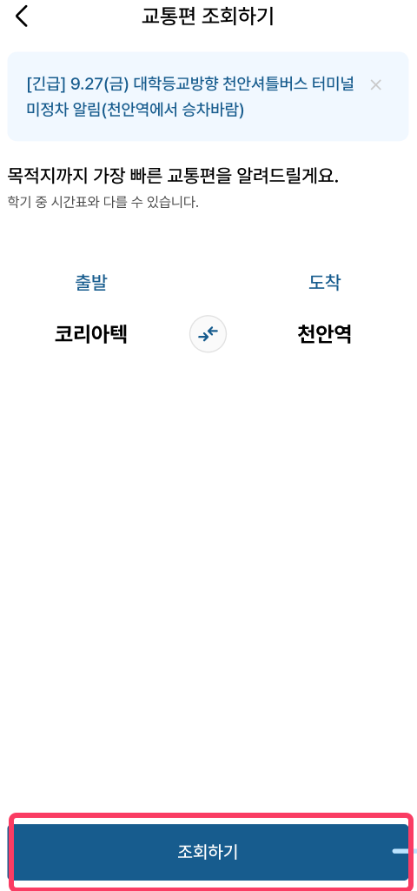
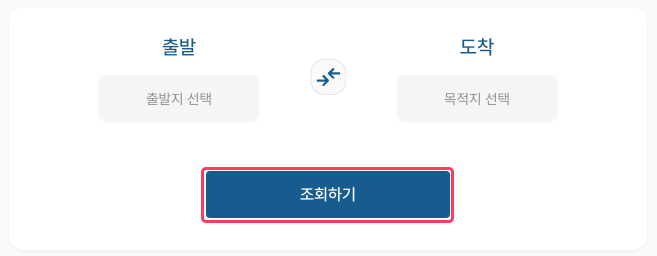
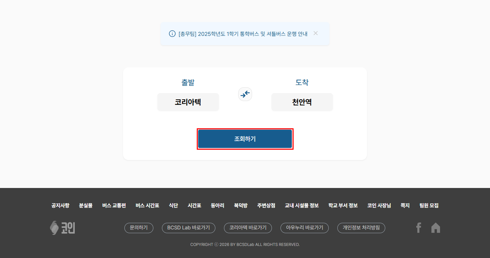

# 5-6. 조회하기_클릭

[← 버스 로깅 목록](README.md)

플랫폼: ANDROID · IOS · WEB  
원문 상태: 완료

과거 로깅·새 로깅과 각 참고사진은 원문의 구간별 연결을 유지합니다.

<!-- logging-section:past:start -->
## 과거 로깅

- event\_label : “search\_bus”
- value : “조회하기<b>”</b>
- event\_category : “click”

AND, IOS, WEB(Mobile View)

WEB

<!-- logging-section:past:end -->

<!-- logging-section:new:start -->
## 새 로깅

- 설명: 버스 교통편 화면에서 조회하기를 클릭해 조회 결과 화면으로 들어가는 경우
- screen\_view: <code>bus_search</code>
- event\_name: <code>DA1</code>
- event\_label: <code>bus__bus_search__search__click</code>
- value: 조회하기
- event\_category: <code>click</code>

### 참고사진 (기능 표시)

#### 웹

웹 — 조회하기 클릭 (출처: stage 실제 캡처, 빨간 네모 = 클릭 위치)

기존 모바일 참고사진 사본 — 이전 로깅에서 ANDROID·IOS·WEB(Mobile View)로 명시된 이미지. 빨간 네모 = 조회하기 버튼. 현행 stage 반응형 웹은 출발·도착 선택 후 즉시 결과를 표시하므로 이 사진을 현행 웹 캡처나 현행 앱 구현 검증으로 사용하지 않는다.

파란색 구버전 모바일 사진 제거 (2026-10-30).

<!-- logging-section:new:end -->

---

원문 정보

원본 ID: `de60221954bc82adb7ed01df276aea7c`  
[보존 원문](../../_archive/original/notion/pages/de60221954bc82adb7ed01df276aea7c.md)

