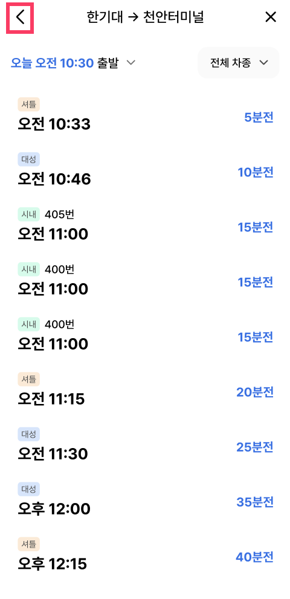

# 5-7. 뒤로가기_클릭

[← 버스 목록](README.md)

플랫폼: ANDROID, IOS  
원문 상태: 완료  
[Notion 기준 명세](https://app.notion.com/p/0860221954bc83deaa2081008af6e0ea)  
원본 ID: `0860221954bc83deaa2081008af6e0ea`

<!-- notion-body:start -->
## 과거 로깅

- 교통편 조회하기 페이지로 이동
- event\_label : “search\_result\_back”
- value : “뒤로가기<b>”</b>
- event\_category : “click”
- 참고사진



## 새 로깅

- 설명: 교통편 조회 결과 화면에서 뒤로가기를 클릭해 버스 교통편 화면으로 돌아가는 경우
- screen\_view: <code>bus_search_result</code>
- event\_name: <code>DA1</code>
- event\_label: <code>bus__bus_search_result__navigation__back__click</code>
- value: 뒤로가기
- event\_category: <code>click</code>

### 참고사진 (기능 표시)

<b>웹</b>

<b>참고사진 · 웹</b>

웹 — 앱 전용 화면 (웹 없음), 앱 캡처 필요

<b>모바일</b>

<b>참고사진 · 모바일</b>

출처: 이 페이지 이전 로깅의 기존 앱 참고사진 사본. 표시 대상은 현행 설명과 대조했으며, 현행 앱의 화면·구현은 미검증입니다. 빨간 네모는 동작 대상입니다.

파란색 구버전 모바일 사진 제거 (2026-10-30).
<!-- notion-body:end -->

<details>
<summary>Notion 원문 속성 전체</summary>

```json
{
  "platform": [
    "ANDROID",
    "IOS"
  ],
  "url": "https://app.notion.com/p/0860221954bc83deaa2081008af6e0ea",
  "구분": "조회 결과 페이지",
  "상태": "완료",
  "생성일": "2026-11-23T13:38:28.360Z",
  "이벤트 이름": "5-7. 뒤로가기\\_클릭",
  "태그": [
    "5. 교통편 조회하기"
  ]
}
```

</details>
