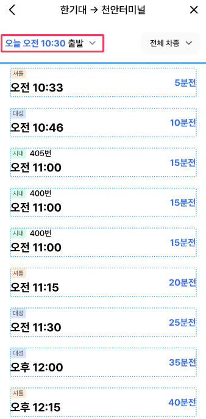
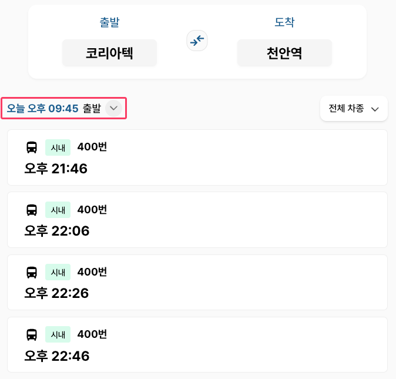
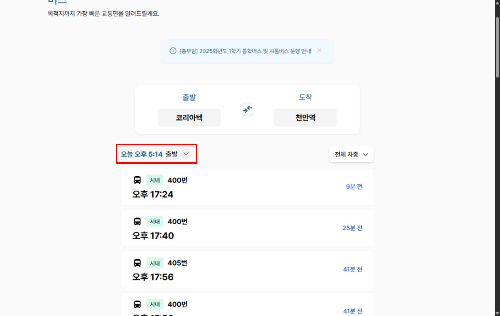
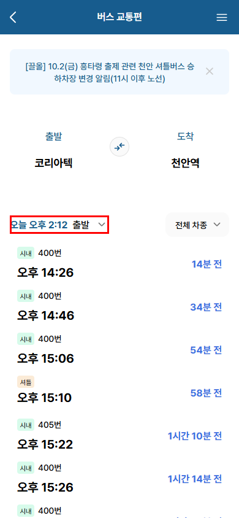

# 5-9. 출발 시각 설정_클릭

[← 버스 로깅 목록](README.md)

플랫폼: ANDROID · IOS · WEB  
원문 상태: 완료

과거 로깅·새 로깅과 각 참고사진은 원문의 구간별 연결을 유지합니다.

<!-- logging-section:past:start -->
## 과거 로깅

- event\_label : “search\_result\_departure\_time”
- value : “출발 시각 설정<b>”</b>
- event\_category : “click”
- 참고사진

AND, IOS, WEB(Mobile view)

WEB

<!-- logging-section:past:end -->

<!-- logging-section:new:start -->
## 새 로깅

- 설명: 교통편 조회 결과 화면에서 출발 시각 설정을 클릭해 출발 시각 설정 창을 여는 경우
- screen\_view: <code>bus_search_result</code>
- event\_name: <code>DA1</code>
- event\_label: <code>bus__bus_search_result__search__departure_time_open__click</code>
- value: 출발 시각 설정
- event\_category: <code>click</code>

### 참고사진 (기능 표시)

<b>웹</b>

<b>참고사진 · 웹</b>

WEB · 빨간 네모: 출발 시각 설정 열기. stage 실제 화면 캡처에 위치 표시.

<b>모바일</b>

<b>참고사진 · 모바일</b>

모바일 웹 · 운영 [https://koreatech.in/bus/route](https://koreatech.in/bus/route) 실제 파란색 화면을 2026-10-30에 캡처. 빨간 테두리: 출발 시각 설정을 여는 오늘·시간 드롭다운. Android/iOS 네이티브 앱 캡처가 아니며 SDK 발화·한 번 전송은 미확인.

<!-- logging-section:new:end -->

---

원문 정보

원본 ID: `d950221954bc839a8a7b814e51af2137`  
[보존 원문](../../_archive/original/notion/pages/d950221954bc839a8a7b814e51af2137.md)

