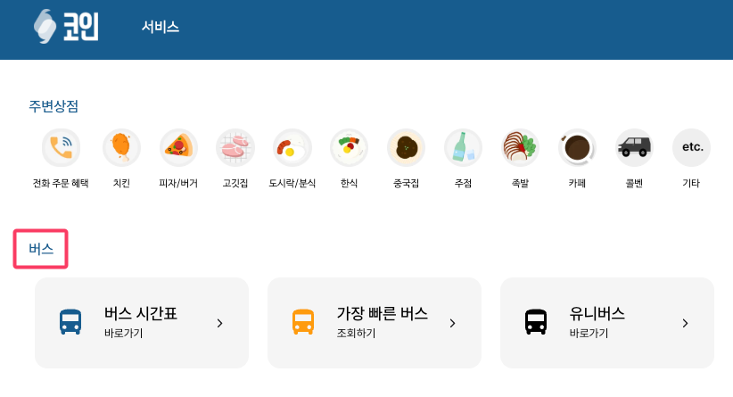
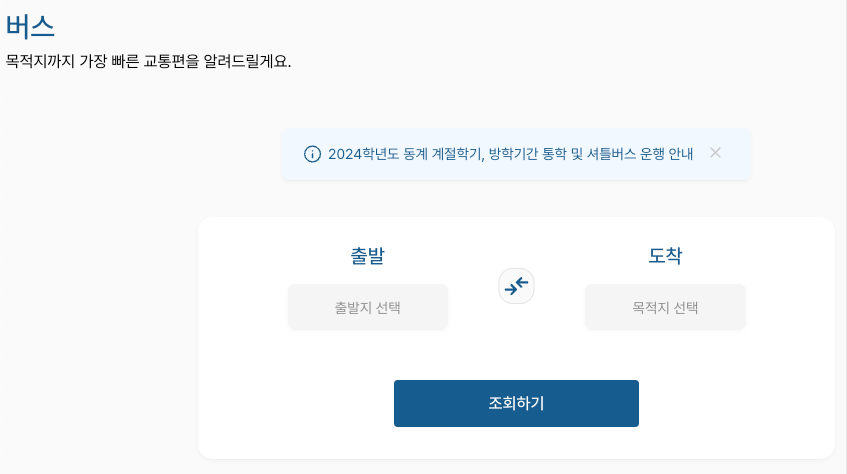

# [레거시] 1-14. 메인_버스_클릭

[← 버스 로깅 목록](README.md)

플랫폼: WEB · ANDROID · IOS  
원문 상태: 레거시

과거 로깅·새 로깅과 각 참고사진은 원문의 구간별 연결을 유지합니다.

원문 미기재 항목: `event_name`, `screen_view`. 값을 추정하지 않았습니다.

<callout icon="📁" color="gray_bg">
<b>레거시 보존 · 현행 기준은 홈화면 리디자인</b>

- 2026-11-05 사용자 지시: 홈화면 리디자인의 로깅은 모두 유지하고, 겹치는 다른 서비스 명세를 레거시로 보존한다.
- 메인 버스 노선 조회의 현행 기준: [1-8 버스 노선 클릭](../10-%ED%99%88%ED%99%94%EB%A9%B4-%EB%A6%AC%EB%94%94%EC%9E%90%EC%9D%B8/1-8-%EB%B2%84%EC%8A%A4-%EB%85%B8%EC%84%A0-%ED%81%B4%EB%A6%AD.md).
- 이 페이지는 별도 신규 구현·추가 전송 대상이 아니다. 아래 라벨·value·category·event\_name·screen\_view·사진·플랫폼과 이전 로깅은 이력으로 보존한다.
- 이전의 ‘이 페이지가 대표’·‘두 문서 별개 유지’·‘같은 라벨 문서 계약’ 설명은 이 최신 결정으로 대체한다. 홈 명세의 라벨·값·필드는 이번 작업에서 변경하지 않는다.
- 실제 SDK의 옛 라벨 중단·전환·단일 전송은 미확인이다. 이 문서 정리는 운영 코드나 데이터의 삭제·변경을 뜻하지 않는다.
</callout>

<!-- logging-section:past:start -->
## 이전 로깅

- event\_label : “main\_to\_bus”
- value : “버스<b>”</b>
- event\_category : “click”
- 참고사진

- 설명 : 클릭 시 \[가장 빠른 버스 조회하기\]와 동일한 버튼

위 화면으로 이동

<!-- logging-section:past:end -->

---

원문 정보

원본 ID: `dee0221954bc82b094ba01067499de71`  
[보존 원문](../../_archive/original/notion/pages/dee0221954bc82b094ba01067499de71.md)

