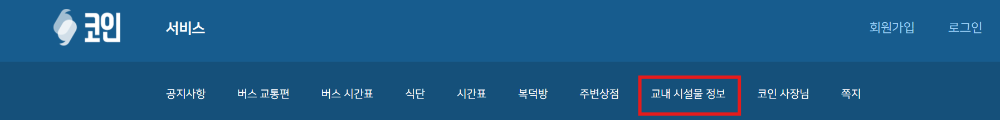
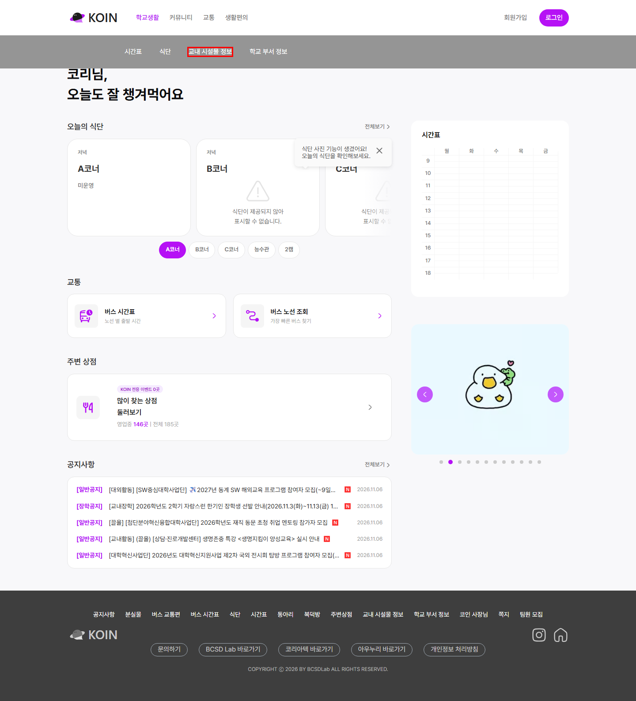

# 10-1. 헤더_교내 시설물 정보_클릭

[← 게시판 목록](README.md)

플랫폼: WEB  
원문 상태: 완료  
[Notion 기준 명세](https://app.notion.com/p/caa0221954bc8368b74a81ba4866e31d)  
원본 ID: `caa0221954bc8368b74a81ba4866e31d`

<!-- notion-body:start -->
## 과거 로깅

- 설명: 헤더 에서 교내 시설물 정보 클릭
- event\_label : “header”
- value : “교내 시설물 정보”
- event\_category : “click”
- 참고사진



## 새 로깅

- 구체적 발생 조건: WEB 리디자인의 상단 ‘학교생활’ 서브 내비게이션에서 ‘교내 시설물 정보’를 클릭한다. 상위 메뉴를 여는 동작은 포함하지 않는다.
- screen\_view: <code>header</code>
- event\_label: <code>facility__header__facility_entry__header_entry__click</code>
- event\_name: <code>DA2</code>
- event\_category: <code>click</code>
- value: 교내 시설물 정보

### 참고사진 (기능 표시)

<b>웹(데스크톱)</b>

<b>참고사진 · 웹 (Stage 실제 화면)</b>

2026-11-08 [Stage 실제 서비스](https://stage.koreatech.in/) · PC 1440px 브라우저에서 직접 촬영했다. 빨간 테두리는 이 명세의 해당 버튼 위치다. 현재 WEB 위치는 이 실제 캡처를 우선한다. 모바일 이미지·로깅 필드·DB 플랫폼은 유지하며 SDK 전송·GA4 수집 검수 완료를 뜻하지 않는다.


<!-- notion-body:end -->

<details>
<summary>Notion 원문 속성 전체</summary>

```json
{
  "platform": [
    "WEB"
  ],
  "url": "https://app.notion.com/p/caa0221954bc8368b74a81ba4866e31d",
  "상태": "완료",
  "이름": "10-1. 헤더\\_교내 시설물 정보\\_클릭",
  "태그": [
    "10. 헤더/푸터/햄버거_교내 시설물 정보"
  ]
}
```

</details>
