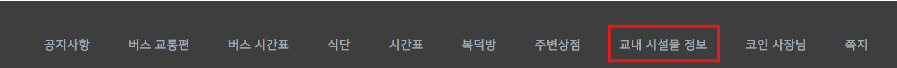
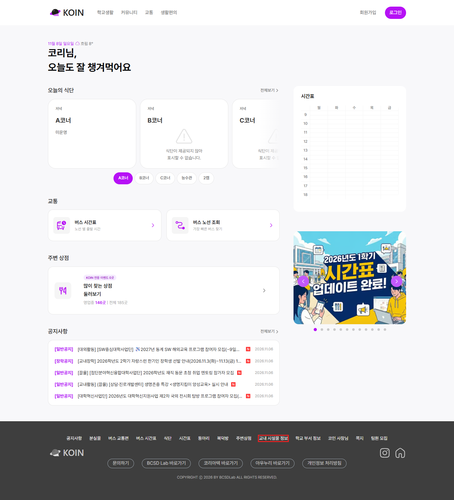

# 10-2. 푸터_교내 시설물 정보_클릭

[← 게시판 로깅 목록](README.md)

플랫폼: WEB  
원문 상태: 완료

과거 로깅·새 로깅과 각 참고사진은 원문의 구간별 연결을 유지합니다.

<!-- logging-section:past:start -->
## 과거 로깅

- 설명: 푸터에서 교내 시설물 정보 클릭
- event\_label : “footer”
- value : “교내 시설물 정보”
- event\_category : “click”
- 참고사진

<!-- logging-section:past:end -->

<!-- logging-section:new:start -->
## 새 로깅

- 구체적 발생 조건: WEB 리디자인의 공통 하단 푸터에서 ‘교내 시설물 정보’ 텍스트를 클릭한다.
- screen\_view: <code>footer</code>
- event\_label: <code>facility__footer__facility_entry__footer_entry__click</code>
- event\_name: <code>DA2</code>
- event\_category: <code>click</code>
- value: 교내 시설물 정보

### 참고사진 (기능 표시)

<b>웹(데스크톱)</b>

<b>참고사진 · 웹 (Stage 실제 화면)</b>

2026-11-08 [Stage 실제 서비스](https://stage.koreatech.in/) · PC 1440px 브라우저에서 직접 촬영했다. 빨간 테두리는 해당 명세의 버튼 위치다. 현재 WEB 위치 확인에는 이 실제 화면을 우선한다. 모바일 사진·기존 로깅 필드·DB 플랫폼 속성은 유지한다. 화면 확인은 SDK 전송·GA4 수집 검수 완료를 뜻하지 않는다.

<!-- logging-section:new:end -->

---

원문 정보

원본 ID: `c150221954bc826fad8901fadcc63f5c`  
[보존 원문](../../_archive/original/notion/pages/c150221954bc826fad8901fadcc63f5c.md)

