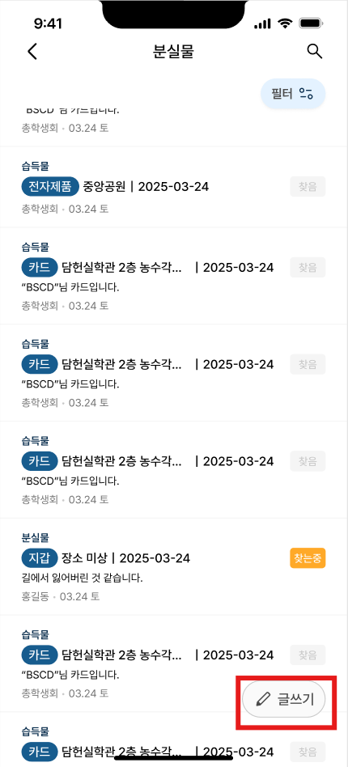
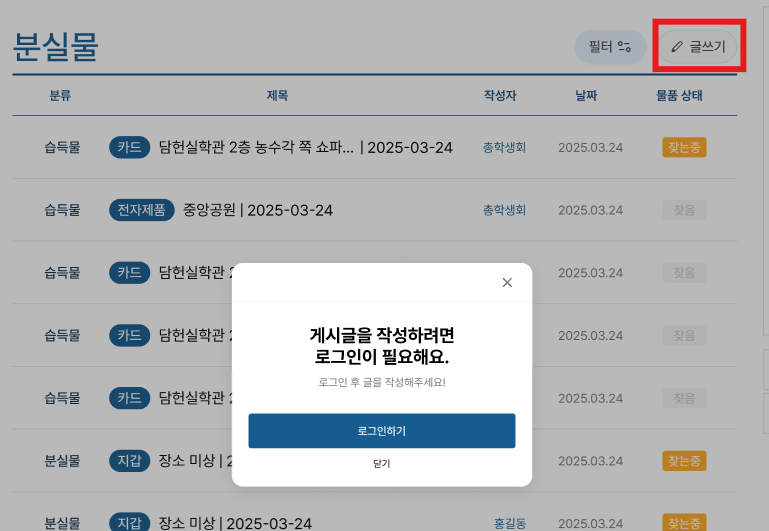
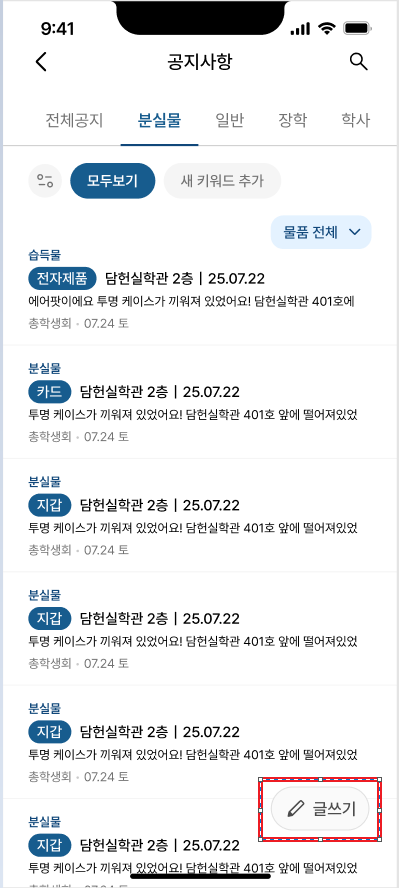
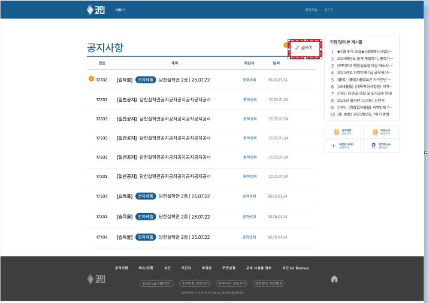
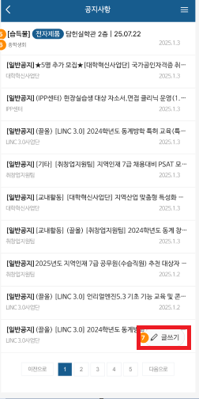
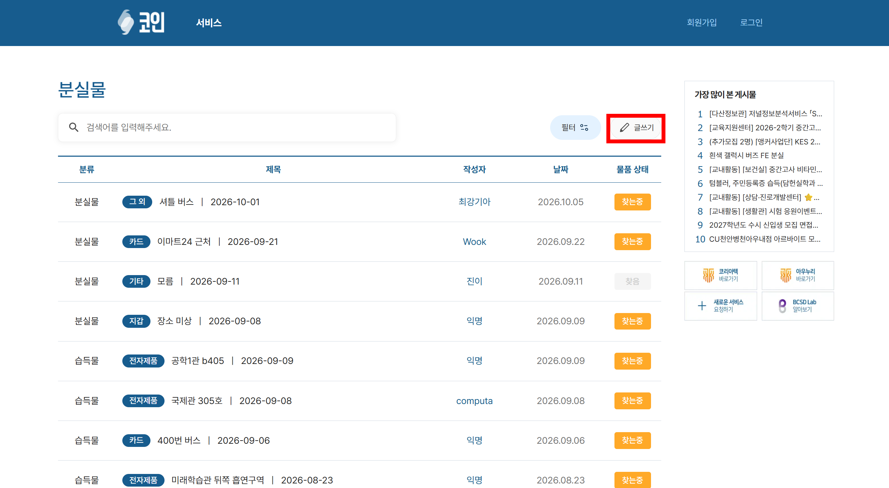
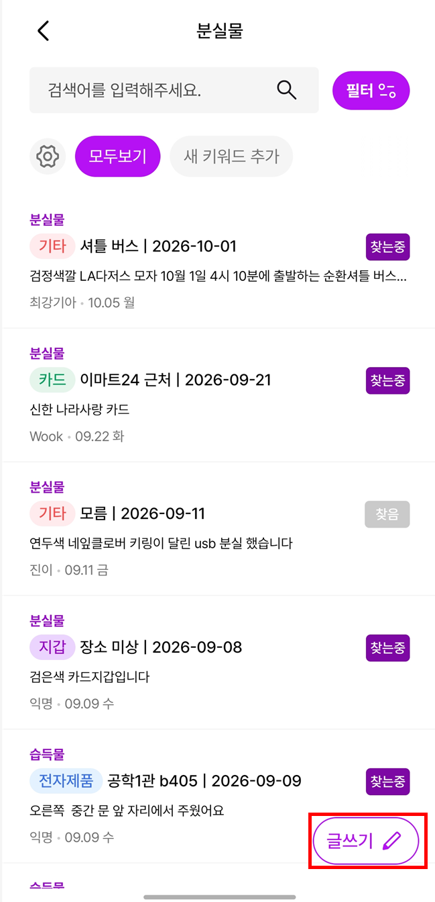

# 11-1.분실물_글쓰기_클릭

[← 게시판 로깅 목록](README.md)

플랫폼: ANDROID · IOS · WEB  
원문 상태: 완료

과거 로깅·새 로깅과 각 참고사진은 원문의 구간별 연결을 유지합니다.

<!-- logging-section:past:start -->
## 과거 로깅

- 설명: 분실물 페이지 에서 글쓰기 버튼 클릭(모바일)
- event\_label : “item\_write”
- value : “글쓰기”
- event\_category : “click”
- 참고사진

<b>이전 참고사진</b>

WEB Mobile View

<!-- logging-section:past:end -->

<!-- logging-section:new:start -->
## 새 로깅

- 설명: 분실물 목록에서 글쓰기 버튼을 눌러 글 작성 흐름으로 진입.
- screen\_view: <code>lost_item_list</code>
- event\_name: <code>DA2</code>
- event\_label: <code>board__lost_item_list__lost_item_write__entry__click</code>
- value: 글쓰기
- event\_category: <code>click</code>

<b>참고사진 (기능 표시)</b>

<b>웹</b>

웹 — 글쓰기

<b>모바일</b>

모바일 — 글쓰기

<!-- logging-section:new:end -->

---

원문 정보

원본 ID: `57d0221954bc83f4b9d601b04f6c3eab`  
[보존 원문](../../_archive/original/notion/pages/57d0221954bc83f4b9d601b04f6c3eab.md)

