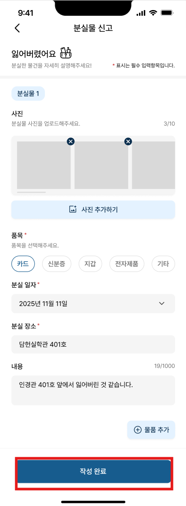
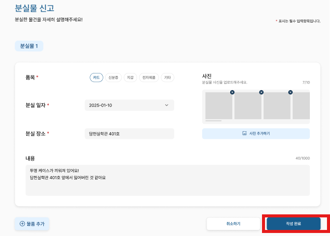
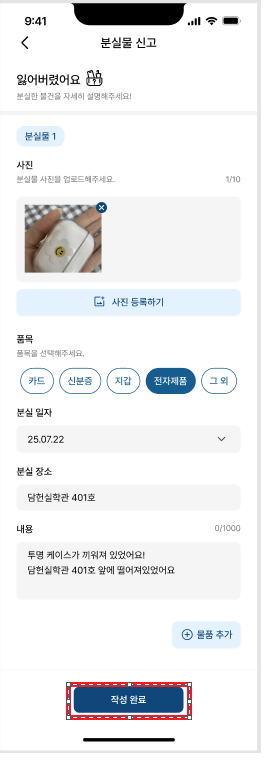
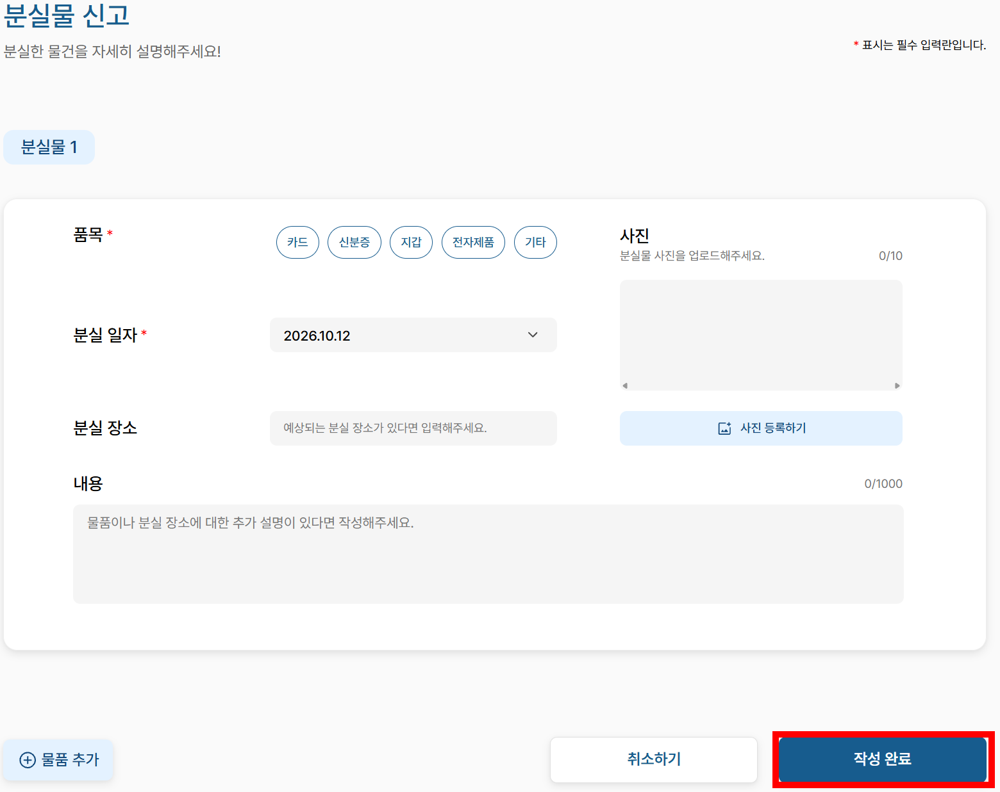
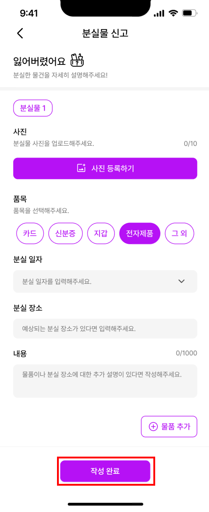

# 11-11.분실물_분실물신고_작성완료_클릭

[← 게시판 목록](README.md)

플랫폼: ANDROID, IOS, WEB  
원문 상태: 완료  
[Notion 기준 명세](https://app.notion.com/p/46c0221954bc8398bce3811a305e8610)  
원본 ID: `46c0221954bc8398bce3811a305e8610`

<!-- notion-body:start -->
## 과거 로깅

- 설명:  습득물 신고 글쓰기 페이지에서 작성완료 클릭
- event\_label : “lost\_item\_write\_confirm”
- value : “작성 완료”
- event\_category : “click”
- 참고사진





<b>이전 참고사진</b>

mobile\_view, mobile\_Web\_view



WEB : 예시 화면이 습득물 신고인데 분실물 신고랑 기능이 동일해서 넣었습니다.


## 새 로깅

- 설명: 분실물 신고 글쓰기 화면에서 작성완료 버튼을 눌러 작성 내용을 제출.
- screen\_view: <code>lost_item_write</code>
- event\_name: <code>DA2</code>
- event\_label: <code>board__lost_item_write__lost_item_write__submit</code>
- value: 작성완료
- event\_category: <code>submit</code>

### 참고사진 (기능 표시)

<b>웹</b>

<b>참고사진 · 웹</b>

웹 — 분실물 작성 완료



<b>모바일</b>

<b>참고사진 · 모바일</b>

모바일 — 분실물 작성 완료


<!-- notion-body:end -->

<details>
<summary>Notion 원문 속성 전체</summary>

```json
{
  "platform": [
    "ANDROID",
    "IOS",
    "WEB"
  ],
  "url": "https://app.notion.com/p/46c0221954bc8398bce3811a305e8610",
  "상태": "완료",
  "이름": "11-11.분실물\\_분실물신고\\_작성완료\\_클릭",
  "태그": [
    "11.분실물"
  ]
}
```

</details>
