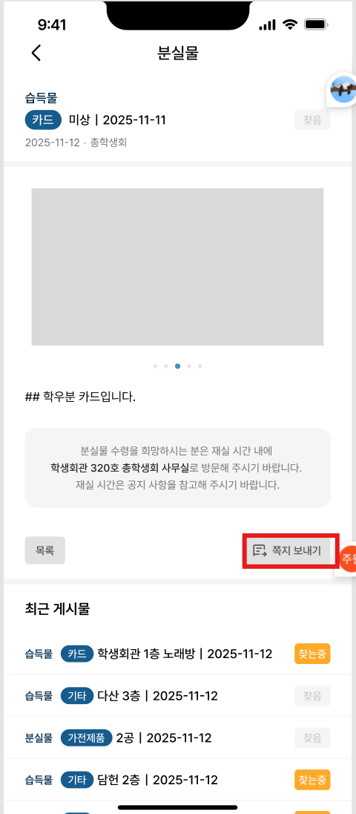
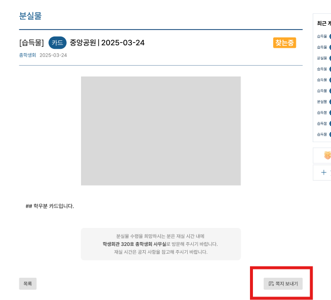
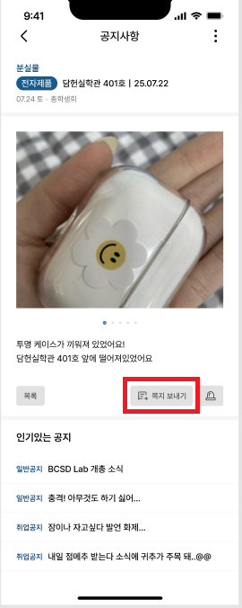
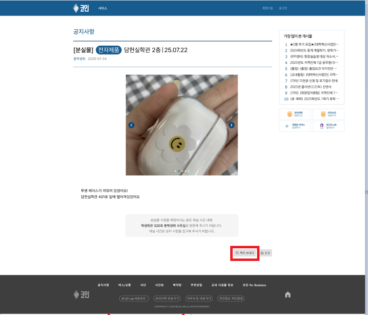
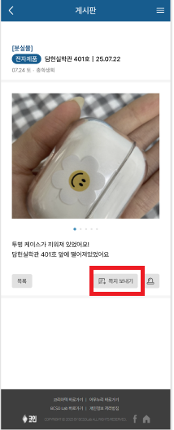
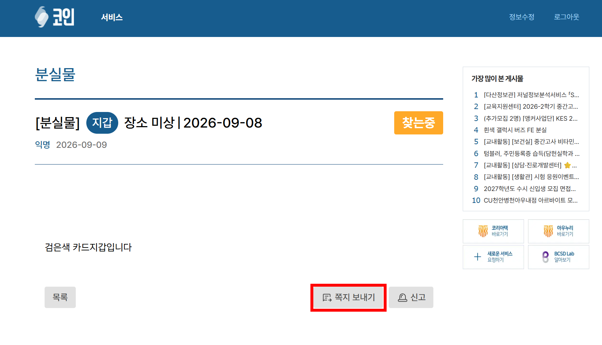
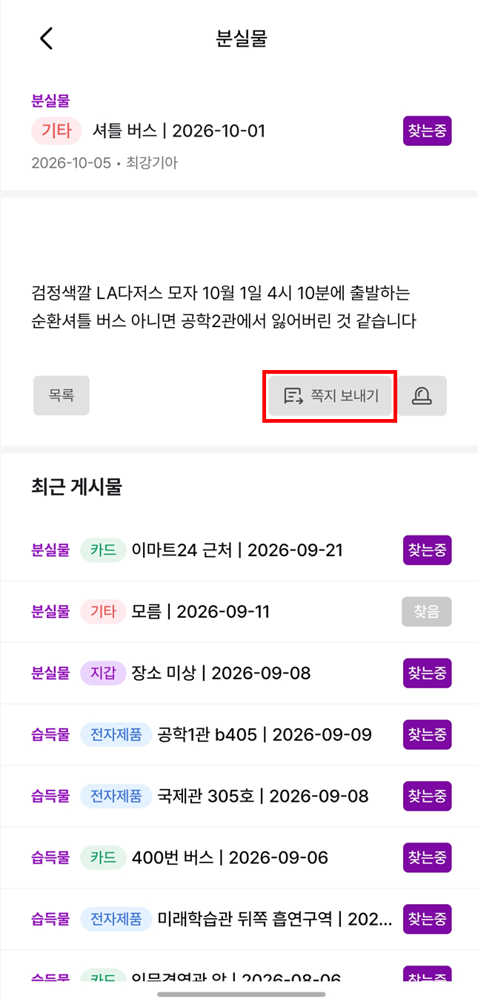

# 11-12.분실물_쪽지보내기_클릭

[← 게시판 로깅 목록](README.md)

플랫폼: ANDROID · IOS · WEB  
원문 상태: 완료

과거 로깅·새 로깅과 각 참고사진은 원문의 구간별 연결을 유지합니다.

<!-- logging-section:past:start -->
## 과거 로깅

- 설명:   게시글에서 쪽지 보내기 버튼 클릭, value 값은 게시글 종류에 따라서 "분실물 쪽지 보내기", "습득물 쪽지 보내기”로 구분
- event\_label : “item\_message\_send”
- value :  "분실물 쪽지 보내기", "습득물 쪽지 보내기”
- event\_category : “click”
- 참고사진

<b>이전 참고사진</b>

mobile\_view, mobile\_Web\_view

WEB

Mobile\_Web\_View

<!-- logging-section:past:end -->

<!-- logging-section:new:start -->
## 새 로깅

- 설명: 게시글에서 쪽지 보내기 버튼 클릭, value 값은 게시글 종류에 따라서 "분실물 쪽지 보내기", "습득물 쪽지 보내기”로 구분
- screen\_view: <code>lost_item_detail</code>
- event\_name: <code>DA2</code>
- event\_label: <code>board__lost_item_detail__lost_item_message__entry__click</code>
- value: 분실물 쪽지 보내기 / 습득물 쪽지 보내기
- event\_category: <code>click</code>

### 참고사진 (기능 표시)

<b>웹</b>

<b>참고사진 · 웹</b>

웹 — 쪽지 보내기

<b>모바일</b>

<b>참고사진 · 모바일</b>

모바일 — 쪽지 보내기

<!-- logging-section:new:end -->

---

원문 정보

원본 ID: `4760221954bc8274b5018173d2ab4000`  
[보존 원문](../../_archive/original/notion/pages/4760221954bc8274b5018173d2ab4000.md)

