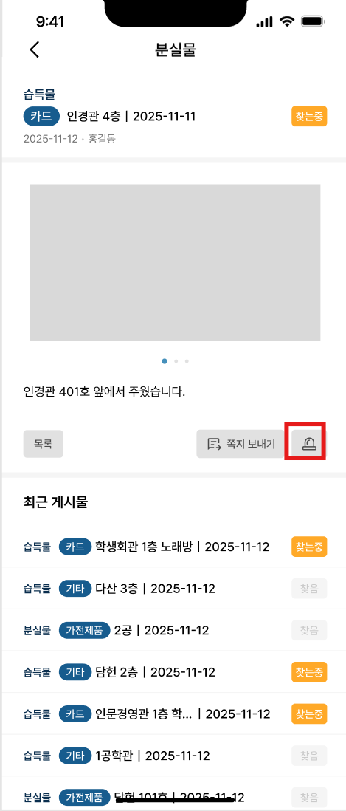
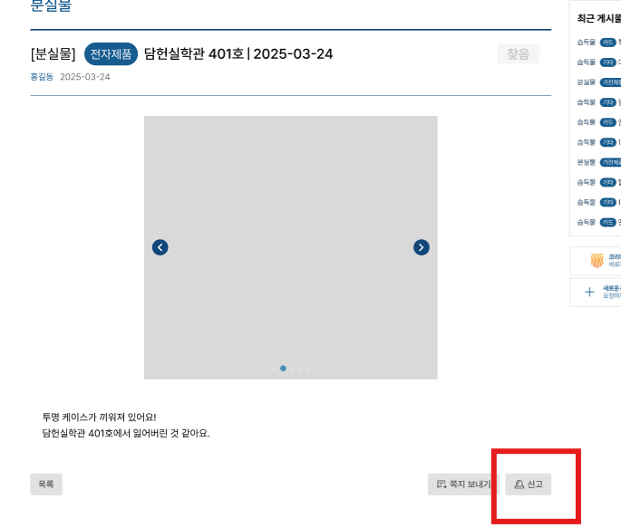
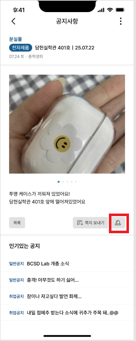
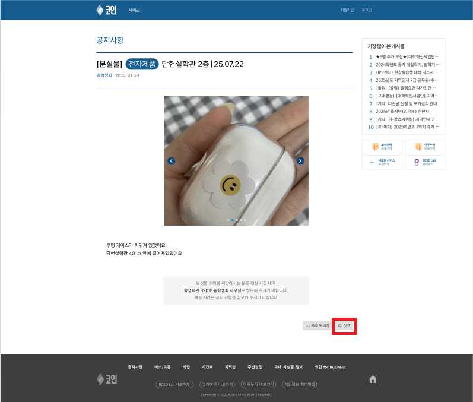
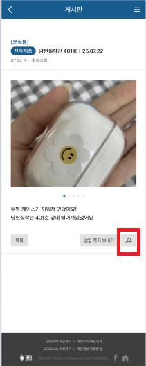
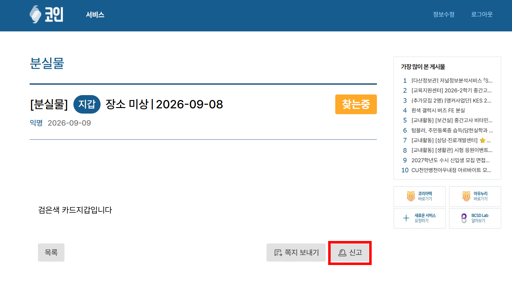
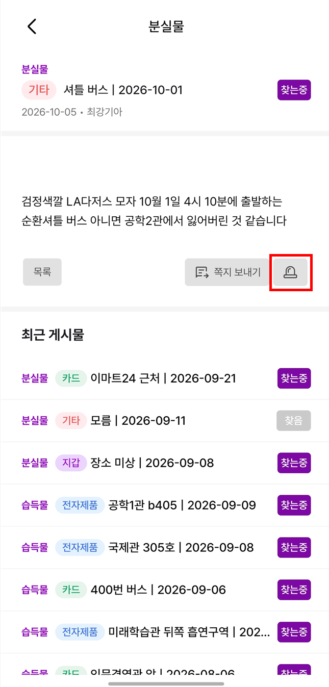

# 11-13.분실물_신고하기_클릭

[← 게시판 로깅 목록](README.md)

플랫폼: ANDROID · IOS · WEB  
원문 상태: 완료

과거 로깅·새 로깅과 각 참고사진은 원문의 구간별 연결을 유지합니다.

<!-- logging-section:past:start -->
## 과거 로깅

- 설명:  게시글에서 신고하기 버튼 클릭
- event\_label : “item\_post\_report”
- value : “신고하기”
- event\_category : “click”

<b>이전 참고사진</b>

mobile\_view

WEB

mobile\_Web\_view

<!-- logging-section:past:end -->

<!-- logging-section:new:start -->
## 새 로깅

- 설명: 게시글에서 신고하기 버튼 클릭
- screen\_view: <code>lost_item_detail</code>
- event\_name: <code>DA2</code>
- event\_label: <code>board__lost_item_detail__lost_item_report__entry__click</code>
- value: 신고하기
- event\_category: <code>click</code>

### 참고사진 (기능 표시)

#### 웹

웹 — 신고

#### 모바일

모바일 — 신고 아이콘

<!-- logging-section:new:end -->

---

원문 정보

원본 ID: `a190221954bc82e2afc801bed93a741d`  
[보존 원문](../../_archive/original/notion/pages/a190221954bc82e2afc801bed93a741d.md)

