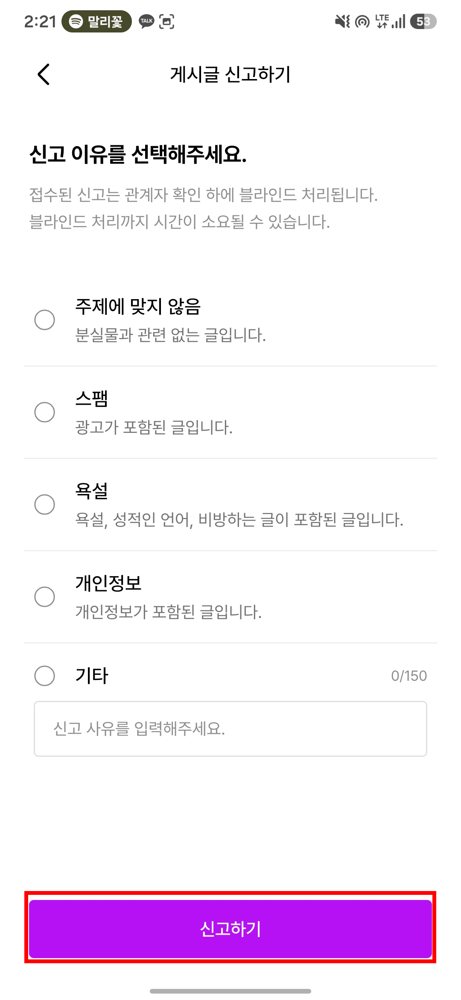

# 11-14.분실물_게시글신고하기_신고하기_클릭

[← 게시판 목록](README.md)

플랫폼: ANDROID, IOS, WEB  
원문 상태: 완료  
[Notion 기준 명세](https://app.notion.com/p/9b30221954bc834689f1819b4f8339aa)  
원본 ID: `9b30221954bc834689f1819b4f8339aa`

<!-- notion-body:start -->
## 과거 로깅

- 설명:  게시글 신고하기에서 신고하기 버튼 클릭
- event\_label : “item\_post\_report\_confirm”
- value : <s>\{”주제에 맞지 않음”, ”스팸”, ”욕설”, ”개인정보”, ”기타”\} 5가지 값중 선택된 값을 추가</s>

→ value : “신고하기”

- event\_category : “click”
- 참고사진


WEB


Mobile\_Web\_VIEW


## 새 로깅

- 설명: 게시글 신고하기에서 신고하기 버튼 클릭
- screen\_view: <code>lost_item_report</code>
- event\_name: <code>DA2</code>
- event\_label: <code>board__lost_item_report__lost_item_report__submit</code>
- value: 신고하기
- event\_category: <code>submit</code>

### 참고사진 (기능 표시)

<b>웹</b>

<b>참고사진 · 웹</b>

PC 웹 — 신고 모달 제출 (기존 로깅 캡처)


<b>모바일</b>

<b>참고사진 · 모바일</b>

모바일 — 별도 신고 화면의 신고하기


<!-- notion-body:end -->

<details>
<summary>Notion 원문 속성 전체</summary>

```json
{
  "platform": [
    "ANDROID",
    "IOS",
    "WEB"
  ],
  "url": "https://app.notion.com/p/9b30221954bc834689f1819b4f8339aa",
  "상태": "완료",
  "이름": "11-14.분실물\\_게시글신고하기\\_신고하기\\_클릭",
  "태그": [
    "11.분실물"
  ]
}
```

</details>
